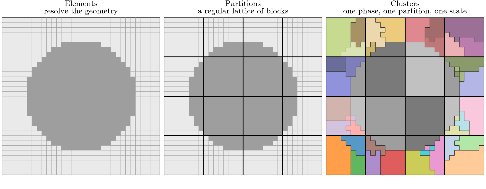
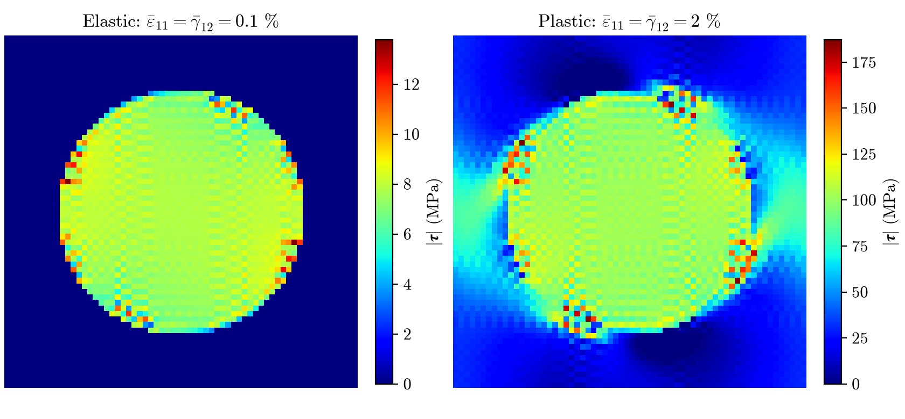
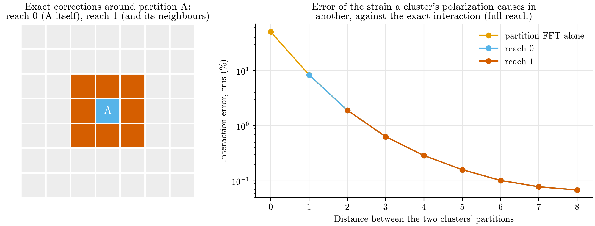
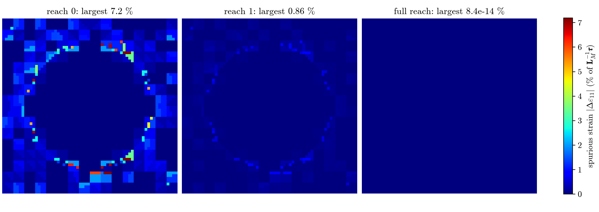

# FFT-TFA: the theory behind the code

**Goal.** Predict the stress–strain response of an elastoplastic composite with a handful of material states, as TFA
does, but compute how those states interact with an FFT on a coarse grid instead of with a dense matrix.

**Reason.** TFA's dense matrix makes memory and cost per iteration grow with the *square* of the number of material
states. An FFT on a grid of $N_{\text{part}}$ cells costs $O(N_{\text{part}}\log N_{\text{part}})$ and stores
$O(N_{\text{part}})$. That is what lets the model be refined.

The lecture derives the method step by step and points to the code for each step. It assumes small-strain elasticity
and knowing what an FFT does. The labels LS-\*, FT-\*, ER-\* are the ones the code's comments cite. Every figure is
computed by the code (`notes/figures/make_figures.py`).

**Contents.** 1 The problem · 2 Three grids · 3 The Lippmann–Schwinger equation · 4 TFA and its cost · 5 The matrix as
reference medium · 6 The clustered equation · 7 A fast interaction · 8 Solving a load step · 9 The methods side by side
· 10 Known limits · Appendix

### Notation

**Where things live.** One letter at three scales: element $\alpha$ lies in cluster $a$, which lies in partition $A$
(and $\beta$ in $b$ in $B$). So Greek $\alpha, \beta$ are **elements**, lowercase $a, b$ are **clusters**, and capital
$A, B$ are **partitions**. Every field is written as a function of where it lives: $\boldsymbol\varepsilon(\alpha)$ is
the strain of element $\alpha$, $\boldsymbol\varepsilon(a)$ the strain of cluster $a$, $\boldsymbol\tau(B)$ the mean
polarization of partition $B$. Plain $x, y$ are points of the cell, used only in the continuous equation LS-5.

**One interaction symbol.** $\boldsymbol\Gamma(\text{target}\leftarrow\text{source})$ is the strain at the target per
unit polarization at the source, averaged over the target and summed over the source. The same symbol serves between
elements, $\boldsymbol\Gamma(\alpha\leftarrow\beta)$; between clusters, $\boldsymbol\Gamma(a\leftarrow b)$; and between
partitions, $\boldsymbol\Gamma(A\leftarrow B)$.

**Labels.** A capital subscript is a name, not an index: $M$ matrix, $I$ inclusion, $0$ reference, $T$ tangent, $P$
plastic.

| Symbol | Meaning |
|---|---|
| $\boldsymbol\varepsilon,\ \boldsymbol\sigma$ | strain, stress (Voigt vectors of 6, engineering shear $\gamma_{12}=2\varepsilon_{12}$) |
| $\boldsymbol\varepsilon_P$ | plastic strain |
| $\boldsymbol\tau$ | polarization: the stress the reference medium gets wrong (section 3) |
| $\bar{\boldsymbol\varepsilon},\ \bar{\boldsymbol\sigma}$ | macro strain and macro stress: cell averages, $\langle\cdot\rangle$ |
| $\mathbf L,\ \mathbf L_M,\ \mathbf L_I$ | elastic stiffness: local, of the matrix, of the inclusion |
| $\mathbf L_0,\ \mathbf L_T$ | stiffness of the reference medium; tangent stiffness $d\boldsymbol\sigma/d\boldsymbol\varepsilon$ |
| $v(a)$ | volume fraction of cluster $a$ in its partition |
| $N_{\text{elem}},\ N_{\text{part}},\ N_{\text{clust}}$ | numbers of elements, partitions, clusters |

---

## 1. The problem

A composite: stiff elastic inclusions (fibers, a sphere, a layer) in a softer matrix that yields plastically. We study
one periodic cubic cell under a **macro strain** $\bar{\boldsymbol\varepsilon}$ that follows a load path, and want
the **macro stress** $\bar{\boldsymbol\sigma}=\langle\boldsymbol\sigma\rangle$ along it. In the cell:

$$
\large
\begin{aligned}
\text{equilibrium:}\quad & \nabla\cdot\boldsymbol\sigma=\mathbf 0\\[2pt]
\text{compatibility:}\quad & \boldsymbol\varepsilon=\bar{\boldsymbol\varepsilon}+\nabla^s\mathbf u,\qquad \mathbf u\ \text{periodic}\\[2pt]
\text{material law:}\quad & \boldsymbol\sigma=\mathbf L\,(\boldsymbol\varepsilon-\boldsymbol\varepsilon_P)
\end{aligned}
$$

$\mathbf L$ is $\mathbf L_M$ in the matrix and $\mathbf L_I$ in the inclusion. The plastic strain
$\boldsymbol\varepsilon_P$ is zero in the elastic inclusion.

**The material law is a black box** (`material.py`; derivation in `notes/background_influence_functions_and_J2/`).
At each load step, given a strain and the plastic history of the previous step, the radial return gives the plastic
strain and the stress, and its derivative gives the tangent:

$$
\large
\boldsymbol\varepsilon\ \longmapsto\ \boldsymbol\varepsilon_P(\boldsymbol\varepsilon),\ \ \boldsymbol\sigma(\boldsymbol\varepsilon),
\qquad\qquad
\mathbf L_T=\frac{d\boldsymbol\sigma}{d\boldsymbol\varepsilon}=\mathbf L\Big(\mathbf I-\frac{d\boldsymbol\varepsilon_P}{d\boldsymbol\varepsilon}\Big)
$$

The rest of the lecture is about the other half: how the material points interact through equilibrium.

> **Why a reduced model.** A full-field solve has unknowns at every element, $10^4$–$10^6$ of them, at every Newton
> iteration of every load step. A reduced model keeps a few material states instead.

---

## 2. Three grids

| Grid | What it is | What it decides |
|---|---|---|
| **Elements** $\alpha$ | a regular mesh that resolves the geometry; each element is matrix or inclusion (its **phase**) | geometry |
| **Partitions** $A$ | a regular lattice of blocks of $k\times k\times k$ elements ($k\times k$ columns if the geometry is constant through the thickness) | speed: they carry the FFT |
| **Clusters** $a$ | elements of one phase inside one partition, sharing **one material state**: one strain, stress and plastic strain | accuracy |

A partition holds one cluster per phase, or more, found by k-means on each element's elastic strain concentration
(`cell.cluster_by_k_means`, as in SCA: Liu–Bessa–Liu 2016, §2.2.1). Each cluster lies inside one partition: that is
what connects the two coarse grids. Spectral LS, the comparison method, is the case of one element per partition and
per cluster.

---

## 3. The Lippmann–Schwinger equation

> **Why.** In a heterogeneous body, how one point responds to another depends on everything around them. In a
> *homogeneous* periodic body, it depends only on the vector between them: the response is a convolution, which an FFT
> turns into a product. So we move the heterogeneity into a source term.

#### Step 1 · Pick a homogeneous reference stiffness $\mathbf L_0$, and call the stress it gets wrong the polarization

$$
\large
\boldsymbol\tau=\boldsymbol\sigma-\mathbf L_0\boldsymbol\varepsilon
=\underbrace{(\mathbf L-\mathbf L_0)\,\boldsymbol\varepsilon}_{\text{elastic contrast}}\ \underbrace{-\ \mathbf L\,\boldsymbol\varepsilon_P}_{\text{plasticity}}
\tag{LS-4}
$$

This is an identity, not an approximation.

#### Step 2 · Substitute into equilibrium

$$
\large
\nabla\cdot\big(\mathbf L_0\,\nabla^s\mathbf u\big)=-\nabla\cdot\boldsymbol\tau
$$

This is the homogeneous medium $\mathbf L_0$, loaded by the polarization.

#### Step 3 · Solve the homogeneous problem with its Green operator

$\boldsymbol\Gamma(x\leftarrow y)$ is the strain at $x$ per unit polarization at $y$, in the reference medium. In a
homogeneous periodic medium it depends only on $x-y$. Then

$$
\large
\boxed{\ \boldsymbol\varepsilon(x)=\bar{\boldsymbol\varepsilon}-\int\boldsymbol\Gamma(x\leftarrow y)\,\boldsymbol\tau(y)\,dy\ }
\tag{LS-5}
$$

This is the **Lippmann–Schwinger equation** (Moulinec–Suquet 1998, eq. 7).

- It is **exact**, for any $\mathbf L_0$.
- It is an **equation**, not a formula: $\boldsymbol\tau$ depends on $\boldsymbol\varepsilon$. We solve it by Newton.
- The integral is a **convolution**. In Fourier space it becomes one $6\times6$ matrix per frequency, known in closed
  form (Moulinec–Suquet 1998, eq. 4; `ls_model.get_moulinec_suquet_kernel`). At zero frequency it is zero, which keeps
  $\langle\boldsymbol\varepsilon\rangle=\bar{\boldsymbol\varepsilon}$.

#### On the elements

With $\boldsymbol\tau$ uniform on each element, the integral becomes a sum over elements:

$$
\large
\boldsymbol\varepsilon(\alpha)=\bar{\boldsymbol\varepsilon}-\sum_\beta\boldsymbol\Gamma(\alpha\leftarrow\beta)\,\boldsymbol\tau(\beta)
$$

Applying it costs one FFT, a $6\times6$ product per frequency and one inverse FFT:
$O(N_{\text{elem}}\log N_{\text{elem}})$ (LS-17, `ls_model.apply_on_lattice`). Solving it with one material state
per element is **Spectral LS**, Moulinec–Suquet's method (`ls_model.SpectralLSSolver`; `notes/2_ls_model.md`
section 4).

---

## 4. Fewer material states: TFA, and its cost

> **Why.** Spectral LS keeps one material state per element. TFA keeps one per cluster: one plastic strain
> $\boldsymbol\varepsilon_P(a)$, updated at the cluster's average strain $\boldsymbol\varepsilon(a)$. The strain itself
> still varies inside a cluster.

From a finite-element model of the composite, TFA precomputes exact influence functions $\mathbf E$ and $\mathbf P$
(`notes/3_tfa_baseline.md`):

$$
\large
\boldsymbol\varepsilon(a)=\mathbf E(a)\,\bar{\boldsymbol\varepsilon}+\sum_b\mathbf P(a\leftarrow b)\,\boldsymbol\varepsilon_P(b)
\tag{ER-4}
$$

This is exact in elasticity. But $\mathbf P$ is **dense**: $(6N_{\text{clust}})^2$ numbers, every product touches all
of them, and building it takes $6N_{\text{clust}}$ FE solves. It cannot be a convolution: moving a pair of clusters
changes what lies around them.

**FFT-TFA's plan:** keep TFA's material model (clusters, one plastic strain each, updated at the cluster's average
strain), and build the interaction from LS-5, whose kernel is a convolution whatever the geometry.

---

## 5. The key choice: the matrix as reference medium

> **Why.** To average LS-5 over clusters, we want $\boldsymbol\tau$ uniform on each cluster. The choice of
> $\mathbf L_0$ decides how true that is.

Take $\mathbf L_0=\mathbf L_M$ in LS-4:

$$
\large
\begin{aligned}
\text{matrix:}\quad & \boldsymbol\tau=-\mathbf L_M\,\boldsymbol\varepsilon_P
&& \text{one plastic strain per cluster}\ \Rightarrow\ \text{uniform, exactly}\\[4pt]
\text{inclusion:}\quad & \boldsymbol\tau=(\mathbf L_I-\mathbf L_M)\,\boldsymbol\varepsilon
&& \text{follows the strain}\ \Rightarrow\ \text{approximated as uniform}
\end{aligned}
$$

The matrix's polarization is exact, whatever the cluster's shape. The inclusion's is taken uniform on each cluster,
at the cluster's average strain: the method's one approximation on the material side. A yielding inclusion would add
$-\mathbf L_I\boldsymbol\varepsilon_P$, uniform like the matrix's.

*A fiber under $\bar\varepsilon_{11}$ and $\bar\gamma_{12}$ (Spectral LS on 64² elements,
$\boldsymbol\tau=\boldsymbol\sigma-\mathbf L_M\boldsymbol\varepsilon$). While elastic, the matrix has no polarization
at all; once it yields, its polarization is its plastic strain. The inclusion's polarization varies with its strain.
The speckle at the interface is the known ringing of the Moulinec–Suquet discretization.*

So each cluster has one unknown, its strain $\boldsymbol\varepsilon(a)$. With $\mathbf L(a)$ the stiffness of its
phase:

$$
\large
\boxed{\
\boldsymbol\tau(a)=\big(\mathbf L(a)-\mathbf L_M\big)\,\boldsymbol\varepsilon(a)-\mathbf L(a)\,\boldsymbol\varepsilon_P(a),
\qquad
\boldsymbol\sigma(a)=\mathbf L(a)\big(\boldsymbol\varepsilon(a)-\boldsymbol\varepsilon_P(a)\big)\ }
\tag{FT-1}
$$

with $\boldsymbol\varepsilon_P(a)$ from the radial return at $\boldsymbol\varepsilon(a)$. With any other
$\mathbf L_0$ the strain term would appear in the matrix too, and the matrix would be approximated as well.

---

## 6. Averaging over clusters: the clustered equation

Insert a polarization uniform on each cluster into LS-5, and average over cluster $a$:

$$
\large
\boldsymbol\varepsilon(a)=\bar{\boldsymbol\varepsilon}-\sum_b\boldsymbol\Gamma(a\leftarrow b)\,\boldsymbol\tau(b),
\qquad
\boldsymbol\Gamma(a\leftarrow b)=\text{mean over }\alpha\text{ in }a\text{ of }\sum_{\beta\text{ in }b}\boldsymbol\Gamma(\alpha\leftarrow\beta)
$$

This has the same form as LS-5, one level up: clusters instead of elements. Given FT-1, it is exact. It is SCA's
clustered equation (Liu–Bessa–Liu 2016, eqs. 16–17) with $\mathbf L_0=\mathbf L_M$. Schneider (2019, §4) compares it
with TFA: the two differ only in whether the Green operator is averaged over the clusters. TFA leaves the strain free
inside a cluster; SCA and FFT-TFA take it uniform.

> **The problem.** $\boldsymbol\Gamma(a\leftarrow b)$ is a dense table of $6\times6$ blocks, one per pair of clusters:
> no cheaper than TFA's $\mathbf P$. Section 7 is the actual idea of FFT-TFA.

---

## 7. A fast interaction: partition FFT plus near corrections

> **Why.** Partitions are translated copies of one block, so an interaction between *partitions* depends only on
> their offset. That makes it a convolution again.

#### Step 1 · The far field, by FFT

Give each partition its mean polarization, and average $\boldsymbol\Gamma$ over partitions just as section 6 averaged
it over clusters (LS-7, `ls_model.get_P0_transformed`):

$$
\large
\boldsymbol\tau(B)=\sum_{b\text{ in }B}v(b)\,\boldsymbol\tau(b),
\qquad
\boldsymbol\Gamma(A\leftarrow B)=\text{mean over }\alpha\text{ in }A\text{ of }\sum_{\beta\text{ in }B}\boldsymbol\Gamma(\alpha\leftarrow\beta)
$$

$\boldsymbol\Gamma(A\leftarrow B)$ depends only on the offset between $A$ and $B$, so
$\sum_B\boldsymbol\Gamma(A\leftarrow B)\,\boldsymbol\tau(B)$ is a convolution on the partitions: one FFT, cost
$O(N_{\text{part}}\log N_{\text{part}})$. It treats each partition's polarization as spread uniformly over it, as
Brisard and Dormieux (2010, §3.2) do with their cells.

#### Step 2 · An exact split

The far field gives cluster $a$ the share $v(b)\,\boldsymbol\Gamma(A\leftarrow B)$ of each cluster $b$. Call what it
misses the **correction**:

$$
\large
\boldsymbol\Gamma_{\text{corr}}(a\leftarrow b)=\boldsymbol\Gamma(a\leftarrow b)-v(b)\,\boldsymbol\Gamma(A\leftarrow B)
$$

Substituting into section 6 gives, still exactly,

$$
\large
\boldsymbol\varepsilon(a)=\bar{\boldsymbol\varepsilon}
-\underbrace{\sum_B\boldsymbol\Gamma(A\leftarrow B)\,\boldsymbol\tau(B)}_{\text{far field, by FFT}}
-\underbrace{\sum_b\boldsymbol\Gamma_{\text{corr}}(a\leftarrow b)\,\boldsymbol\tau(b)}_{\text{corrections}}
$$

The corrections account for *where* inside their partitions the two clusters lie.

#### Step 3 · Keep the corrections only nearby

Seen from far away, a cluster looks like its partition's mean, so the correction shrinks with distance. We keep it
only between partitions within `reach` of each other: reach 0 is the partition itself, reach 1 adds its neighbours.

*A fiber on 64² elements, 16² partitions, two k-means matrix clusters per partition. The error is a volume-weighted
rms over all cluster pairs at each distance, as a share of the exact interaction within a partition. The far field
alone is 50 % off within a partition, 8 % between neighbours, 2 % two partitions apart. Reach 0 makes the first exact,
reach 1 the second. This average hides a slower far field for small clusters (section 10).*

#### Step 4 · Restore the mean strain

The exact interaction averages to zero over the cell; the truncated one does not quite. So subtract its cell average,
$\langle\,\cdot\,\rangle=\frac1{N_{\text{part}}}\sum_b v(b)\,(\cdot)(b)$. Then
$\langle\boldsymbol\varepsilon\rangle=\bar{\boldsymbol\varepsilon}$ exactly, and the cluster stresses average to the
macro stress.

#### Result · FFT-TFA's interaction (`fft_tfa_model.get_strain_change`)

With $\Delta\boldsymbol\varepsilon(a)$ the strain change the polarizations cause in cluster $a$:

$$
\large
\boxed{\
\begin{aligned}
\boldsymbol\varepsilon(a)&=\bar{\boldsymbol\varepsilon}-\big(\Delta\boldsymbol\varepsilon(a)-\langle\Delta\boldsymbol\varepsilon\rangle\big)\\[4pt]
\Delta\boldsymbol\varepsilon(a)&=\sum_B\boldsymbol\Gamma(A\leftarrow B)\,\boldsymbol\tau(B)\ +\sum_{b\text{ within reach}}\boldsymbol\Gamma_{\text{corr}}(a\leftarrow b)\,\boldsymbol\tau(b)
\end{aligned}\ }
\tag{FT-2, FT-4}
$$

We write this as $\boldsymbol\varepsilon=\bar{\boldsymbol\varepsilon}-\boldsymbol\Gamma_{\text{FFT-TFA}}\,\boldsymbol\tau$:
$\boldsymbol\Gamma_{\text{FFT-TFA}}$ is FFT-TFA's approximation of $\boldsymbol\Gamma(a\leftarrow b)$.

#### Computing the corrections (`fft_tfa_model.get_correction_blocks`, offline, once)

$\boldsymbol\Gamma(\alpha\leftarrow\beta)$ depends only on the offset between the two elements, so write it
$\boldsymbol\Gamma(\text{offset})$. For $\alpha$ in $A$ and $\beta$ in $B$, with $k$ elements per partition side:

$$
\large
\text{offset from }\beta\text{ to }\alpha\;=\;k\,\mathbf D+\boldsymbol\delta,
\qquad
\begin{aligned}
\mathbf D&=\text{offset from }B\text{ to }A,\ \text{in partitions}\\
\boldsymbol\delta&=\text{offset of }\alpha\text{ inside }A\text{ minus that of }\beta\text{ inside }B,\ \text{in elements}
\end{aligned}
$$

So the sum over element pairs only needs to know how many pairs share each $\boldsymbol\delta$:

$$
\large
\boldsymbol\Gamma_{\text{corr}}(a\leftarrow b)=\frac{1}{\lvert a\rvert}\sum_{\boldsymbol\delta}\text{pairs}(a,b,\boldsymbol\delta)\ \boldsymbol\Gamma\big(k\mathbf D+\boldsymbol\delta\big)\ -\ v(b)\,\boldsymbol\Gamma(A\leftarrow B)
\tag{FT-3}
$$

with $\lvert a\rvert$ the number of elements of $a$. The counts $\text{pairs}(a,b,\boldsymbol\delta)$, for every
offset at once, are the cross-correlation of the two clusters' indicator arrays: one FFT, padded to twice the
partition so offsets do not wrap around. The method stores one $6\times6$ block per pair of clusters within reach.

#### Two checks of the derivation

- With **one element per partition**, every correction vanishes, and FFT-TFA is Spectral LS with
  $\mathbf L_0=\mathbf L_M$.
- At **full reach** nothing is truncated, and $\boldsymbol\Gamma_{\text{FFT-TFA}}=\boldsymbol\Gamma(a\leftarrow b)$,
  the exact clustered equation of section 6. `check.py` confirms this to round-off on every problem
  (`get_interaction_error`).

---

## 8. Solving a load step

Newton's method needs a residual, the linear system for a correction $\delta\boldsymbol\varepsilon$, and a
preconditioner for that system:

$$
\large
\begin{aligned}
\text{residual:}\quad & \mathbf r=\boldsymbol\varepsilon-\bar{\boldsymbol\varepsilon}+\boldsymbol\Gamma_{\text{FFT-TFA}}\,\boldsymbol\tau(\boldsymbol\varepsilon) && \text{(FT-5)}\\[6pt]
\text{Newton system:}\quad & \delta\boldsymbol\varepsilon+\boldsymbol\Gamma_{\text{FFT-TFA}}\,(\mathbf L_T-\mathbf L_M)\,\delta\boldsymbol\varepsilon=-\mathbf r && \text{(FT-6)}\\[6pt]
\text{preconditioner:}\quad & \text{invert each cluster's own }6\times6\text{ block}\quad \mathbf I+\boldsymbol\Gamma_{\text{FFT-TFA}}(a\leftarrow a)\,\big(\mathbf L_T(a)-\mathbf L_M\big) && \text{(FT-7)}
\end{aligned}
$$

- **FT-5** is a strain error, like TFA's. Convergence is judged on it directly: with $\mathbf L_0=\mathbf L_M$ it is
  already the "matrix units" measure that Spectral LS has to compute (LS-24, `notes/2_ls_model.md` section 4.3).
- **FT-6**: $\mathbf L_T-\mathbf L_M$ is how each cluster's polarization changes with its strain. The system is never
  assembled: each product is one partition FFT and one sparse product. It is not symmetric, so GMRES solves it.
- **FT-7** (block-Jacobi) keeps GMRES at 10–20 iterations. Its blocks are built once
  (`fft_tfa_model.get_own_strain_change`).

A cluster's effect on itself, which FT-7 inverts, is the far field's self-term, plus the cluster's own correction,
minus its share of the mean:

$$
\large
\boldsymbol\Gamma_{\text{FFT-TFA}}(a\leftarrow a)=v(a)\,\boldsymbol\Gamma(A\leftarrow A)+\boldsymbol\Gamma_{\text{corr}}(a\leftarrow a)-\frac1{N_{\text{part}}}\sum_b v(b)\,\boldsymbol\Gamma_{\text{corr}}(b\leftarrow a)
$$

**One load step** (`newton.Solver.solve_step`):
1. Start from the previous strains plus the macro strain increment.
2. Evaluate FT-1 and FT-5.
3. Solve FT-6 for $\delta\boldsymbol\varepsilon$ by GMRES, and step with a backtracking line search.
4. Repeat until the relative residual is below `convergence_tolerance`, then accept the plastic history.

---

## 9. The methods side by side

| | Material states | Uniform per state | Interaction | Stored | Cost per product |
|---|---|---|---|---|---|
| **FFT-TFA** | clusters | $\boldsymbol\varepsilon_P$, $\boldsymbol\varepsilon$ | partition FFT + near corrections | kernel on the partitions + blocks within reach | $O(N_{\text{part}}\log N_{\text{part}})$ + near blocks |
| **Spectral LS** | elements | everything | element FFT | kernel and fields on the elements | $O(N_{\text{elem}}\log N_{\text{elem}})$ |
| **TFA** | clusters | $\boldsymbol\varepsilon_P$ | exact FE influence functions | dense, $(6N_{\text{clust}})^2$ | $O(N_{\text{clust}}^2)$ |
| SCA (not in the code) | clusters | $\boldsymbol\varepsilon_P$, $\boldsymbol\varepsilon$ | clustered LS operator | dense, $(6N_{\text{clust}})^2$ | $O(N_{\text{clust}}^2)$ |

**Where FFT-TFA's error against TFA on the same clusters comes from.** It has three parts, each measurable with the
code:

1. the inclusion's polarization taken uniform per cluster (FFT-TFA at full reach against TFA);
2. the truncation (FFT-TFA against itself at full reach);
3. the Moulinec–Suquet kernel against TFA's finite elements.

**Relation to the literature.**
- **Moulinec–Suquet (1998):** the reference-medium equation and its FFT solution.
- **SCA (Liu–Bessa–Liu 2016):** the clustered equation, with $\boldsymbol\Gamma(a\leftarrow b)$ built as a dense matrix
  on the fine grid (their eq. 27). They found a reference medium equal to the matrix too stiff once the matrix yields
  (§3.2, Fig. 5), and update it self-consistently at every increment. FFT-TFA keeps $\mathbf L_M$ fixed, which makes
  the matrix's polarization exact (section 5) and leaves one kernel, built once.
- **Brisard–Dormieux (2010, 2012):** the same regular cells with one polarization each, in linear elasticity. FFT-TFA
  adds clusters inside the cells, with exact corrections between nearby ones.
- **Zhang et al. (2019, §2.3):** cluster interactions on a uniform coarse grid too, by cell-to-cell integrals with the
  cross terms inside a cell set to zero, assembled into a dense matrix, with neither FFT nor corrections.

---

## 10. Known limits

#### The patch test

A polarization that is the same everywhere must cause no strain. The far field gives zero for it, so the corrections
from *all* clusters must cancel, and the truncated sum does not:

$$
\large
\sum_{\text{all }b}\boldsymbol\Gamma_{\text{corr}}(a\leftarrow b)=\mathbf 0
\qquad\text{but}\qquad
\sum_{b\text{ within reach}}\boldsymbol\Gamma_{\text{corr}}(a\leftarrow b)\neq\mathbf 0
$$

The far corrections, small one by one, add up to a spurious strain. This happens in partitions that hold several
clusters. In a partition holding one cluster, the corrections from each source partition already sum to zero.

*A uniform polarization on the same cell as the reach figure: up to 7 % spurious strain at reach 0, under 1 % at
reach 1, round-off at full reach.*

One could correct only each partition's deviation from its mean. That variant passes the patch test exactly, but it
drops a real part of the interaction and measured less accurate with neighbours (126-fiber cell, sphere), so it is not
used.

#### The far field of small clusters

The reach figure is an average. It hides two things:
- **Against the true far field**, the truncation error falls slowly. On the same cell, the far field alone is still
  about 10 % off the exact interaction eight partitions away (3 % with one cluster per phase).
- **Small clusters see more of it.** For clusters of a few elements, the largest error levels off near 3 % of the
  source's own response instead of decaying. Our reading, from a pair inspected far from its source: the exact
  element-level field still varies from element to element there. This is the discrete kernel's high-frequency
  content, the same ringing as in the polarization figure. A partition's mean averages it out; a small cluster does
  not.

#### Other limits

Measured on `check.py`'s problems and in studies (README, "Status and roadmap"):
- **Structures that cut through partitions in a line add up their far-field error.** A layer whose interfaces cut
  partitions is 25 % off in its worst cluster at reach 0, 15 % at reach 1, 9 % at reach 2, and exact at full reach.
- **σ33 along z-invariant fibers runs low.** On a 30-fiber cell, against a fine Spectral LS reference, it is −6 % at
  full reach, where TFA gives −0.1 %. Of the three parts in section 9, this comes from part 1: one polarization per
  inclusion cluster.
- **Clusters of a few elements** can give the clustered problem several solutions (TFA's too).

---

## Appendix

#### The equations in the code

| Equation | Code |
|---|---|
| Material law, $\mathbf L_T$ | `material.radial_return`, `material.get_algorithmic_stiffness` |
| LS-5 on the elements: kernel and FFT product (LS-21, LS-17) | `ls_model.get_moulinec_suquet_kernel`, `ls_model.apply_on_lattice` |
| $\boldsymbol\Gamma(A\leftarrow B)$ (LS-7) | `ls_model.get_P0_transformed`, `average_over_partitions` |
| FT-1, FT-5: polarization, residual | `fft_tfa_model.FFTTFASolver.evaluate` |
| FT-2, FT-4: interaction | `fft_tfa_model.get_strain_change`, built by `get_interaction` |
| FT-3: corrections | `fft_tfa_model.get_correction_blocks` |
| FT-6, FT-7: Newton system, preconditioner | `fft_tfa_model.FFTTFASolver.get_newton_correction`, `get_own_strain_change` |
| Newton loop, line search, GMRES | `newton.Solver`, `newton.solve_by_gmres` |
| Clusters | `cell.cluster_by_phase`, `cell.cluster_by_k_means`, `cell.get_clusters` |

#### Names in the code and in the other notes

| Here | Code | `notes/2_ls_model.md`, `notes/3_tfa_baseline.md` |
|---|---|---|
| $\mathbf L_0$, $\mathbf L_M$ | `C0`, `matrix_L` | $\mathbf C_0$, $\mathbf L_m$ |
| $\boldsymbol\varepsilon_P$ | `plastic_strain` | $\boldsymbol\mu$, the eigenstrain |
| $v(a)$ | `Clusters.share` | $c_p$ |
| $\boldsymbol\Gamma(\alpha\leftarrow\beta)$, $\boldsymbol\Gamma(A\leftarrow B)$ | `element_D0`, `partition_D0` (`P0_transformed` holds $\boldsymbol\Gamma(A\leftarrow B)\,\mathbf L_0$ in Fourier space) | $\mathbf D_0$, $\bar{\mathbf D}_0$ |
| $\boldsymbol\Gamma_{\text{corr}}(a\leftarrow b)$ | `correction_blocks` | $\mathbf C_{pt}$ |
| $\boldsymbol\Gamma_{\text{FFT-TFA}}$, its own blocks | `get_strain_change`, `own_strain_change` | $\mathbf G$, $\mathbf G_{pp}$ |
