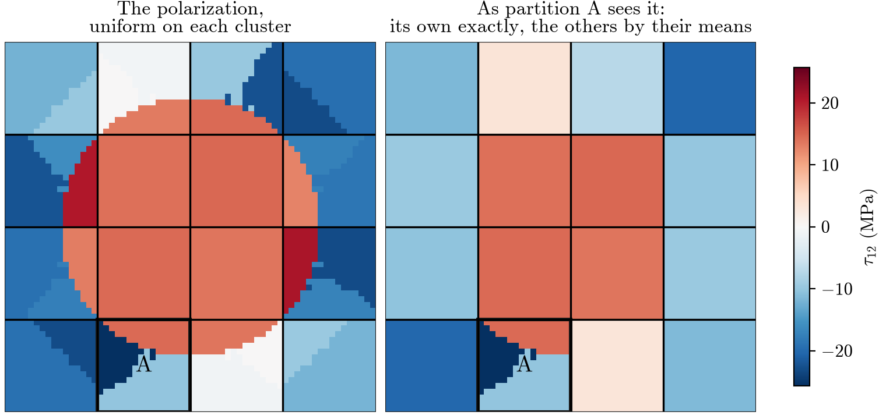

# FFT-TFA: the theory behind the code

**Goal.** Predict the stress–strain response of an elastoplastic composite with a handful of material states, as TFA
does, but compute how those states interact with an FFT on a coarse grid instead of with a dense matrix.

**Reason.** TFA's dense matrix makes memory and cost per iteration grow with the *square* of the number of material
states. An FFT on a grid of $N_{\text{part}}$ blocks costs $O(N_{\text{part}}\log N_{\text{part}})$ and stores
$O(N_{\text{part}})$, whatever the number of material states inside the blocks. That is what lets the model be refined.

**How to read it.** The derivation starts from the exact cell problem and adds one assumption at a time, each stated in
a box where it is made. Each section opens by saying what we have so far, what is missing, and what the section does
about it. Every step says what it does (substitute, rearrange, define, average) and shows the result. The lecture
assumes small-strain elasticity and knowing what an FFT does. The labels LS-\*, FT-\*, ER-\* are the ones the code's
comments cite, which is why they are not consecutive. Every figure is computed by the code
(`notes/figures/make_figures.py`). Papers are cited by author and year.

**The road.** Each assumption buys fewer unknowns or a cheaper interaction:

| | Assumption | Section | Unknowns | Equations | One product of the interaction |
|---|---|---|---|---|---|
| | the cell problem | 1, 3 | a field | a field | |
| A0 | the polarization is uniform on each element | 3 | $N_{\text{elem}}$ | $N_{\text{elem}}$ | $O(N_{\text{elem}}\log N_{\text{elem}})$: **Spectral LS** |
| A1, A2 | one eigenstrain per cluster; the inclusion's polarization uniform per cluster | 4 | $N_{\text{clust}}$ | $N_{\text{elem}}$, too many | |
| A3 | the equation holds on average over each cluster | 5 | $N_{\text{clust}}$ | $N_{\text{clust}}$ | $O(N_{\text{clust}}^2)$, dense: **SCA** with $\mathbf C_0=\mathbf L_M$ |
| A4 | between partitions, each cluster is seen through its polynomial fit of degree $d$ | 6, 7 | $N_{\text{clust}}$ | $N_{\text{clust}}$ | $O(N_{\text{part}}\log N_{\text{part}})$ + a few blocks per partition: **FFT-TFA** |

One ingredient is a choice, not an assumption: the matrix as reference medium, $\mathbf C_0=\mathbf L_M$ (section 4).
A4 becomes exact as the degree is raised, so FFT-TFA converges to the clustered equation of A0–A3.

**Contents.** 1 The problem · 2 Three grids · 3 The Lippmann–Schwinger equation · 4 One state per cluster · 5 The
clustered equation · 6 FFT-TFA at degree 0: each other partition by its mean · 7 Beyond the mean: polynomial moments ·
8 Solving a load step · 9 The methods side by side · 10 Known limits · Appendix: A the material law, B Spectral LS, C
TFA, D FFT-TFA's polynomials and tables, E the equations in the code, F names in the code, G symbols

**Where things live.** One letter at three scales: element $\alpha$ lies in cluster $a$, which lies in partition $A$
(and $\beta$ in $b$ in $B$). So Greek $\alpha, \beta$ are **elements**, lowercase $a, b$ are **clusters**, and capital
$A, B$ are **partitions**. Every field is written as a function of where it lives: $\boldsymbol\varepsilon(\alpha)$ is
the strain of element $\alpha$, $\boldsymbol\varepsilon(a)$ the strain of cluster $a$, and $\langle f\rangle_a$,
$\langle f\rangle_A$ are averages over a cluster, a partition. $\boldsymbol\Gamma_0$ is the element kernel; a **hat**
marks its average over groups of elements, $\hat{\boldsymbol\Gamma}$. Every symbol is listed in Appendix G.

---

## 1. The problem

**This section.** States what is solved: one periodic cell of a composite, loaded by a macro strain, and why we want a
reduced model of it.

A composite: stiff elastic inclusions (fibers, a sphere, a layer) in a softer matrix that yields plastically. We study
one periodic cubic cell under a **macro strain** $\bar{\boldsymbol\varepsilon}$ that follows a load path, and want
the **macro stress** $\bar{\boldsymbol\sigma}=\langle\boldsymbol\sigma\rangle$ along it. In the cell:

$$
\large
\begin{aligned}
\text{material law:}\quad & \boldsymbol\sigma=\mathbf L\,(\boldsymbol\varepsilon-\boldsymbol\mu)\\[2pt]
\text{compatibility:}\quad & \boldsymbol\varepsilon=\bar{\boldsymbol\varepsilon}+\nabla^s\mathbf u,\qquad \mathbf u\ \text{periodic}\\[2pt]
\text{equilibrium:}\quad & \nabla\cdot\boldsymbol\sigma=\mathbf 0
\end{aligned}
$$

$\mathbf L$ is $\mathbf L_M$ in the matrix and $\mathbf L_I$ in the inclusion. The eigenstrain $\boldsymbol\mu$ is the
plastic strain, zero in the elastic inclusion.

**The material law is a black box** (`material.py`; the equations are in Appendix A).
At each load step, given a strain and the plastic history of the previous step, the radial return gives the plastic
strain and the stress, and its derivative gives the tangent:

$$
\large
\boldsymbol\varepsilon\ \longmapsto\ \boldsymbol\mu(\boldsymbol\varepsilon),\ \ \boldsymbol\sigma(\boldsymbol\varepsilon),
\qquad\qquad
\mathbf L_T=\frac{d\boldsymbol\sigma}{d\boldsymbol\varepsilon}=\mathbf L\Big(\mathbf I-\frac{d\boldsymbol\mu}{d\boldsymbol\varepsilon}\Big)
$$

The rest of the lecture is about the other half: how the material points interact through equilibrium.

**Why a reduced model.** A full-field solve has unknowns at every element, $10^4$–$10^6$ of them, at every Newton
iteration of every load step. A reduced model keeps a few material states instead.

---

## 2. Three grids

**This section.** Introduces the three grids every method is built on: elements for the geometry, partitions for the
FFT, clusters for the material states.

*Figure 1. The three grids on a fiber: 32² elements, 4² partitions, three matrix clusters per partition's matrix part.*

| Grid | What it is | What it decides |
|---|---|---|
| **Elements** $\alpha$ | a regular mesh that resolves the geometry; each element is matrix or inclusion (its **phase**) | geometry |
| **Partitions** $A$ | a regular lattice of blocks of $k\times k\times k$ elements ($k\times k$ columns if the geometry is constant through the thickness) | speed: they carry the FFT |
| **Clusters** $a$ | elements of one phase inside one partition, sharing **one material state**: one strain, stress and plastic strain | accuracy |

A partition holds one cluster per phase, or more, found by k-means on each element's elastic strain concentration
(`cell.cluster_by_k_means`, as in SCA: Liu–Bessa–Liu 2016, §2.2.1). Each cluster lies inside one partition: that is
what connects the two coarse grids. $v(a)=\lvert a\rvert/\lvert A\rvert$ is cluster $a$'s share of its partition, with
$\lvert a\rvert$, $\lvert A\rvert$ their numbers of elements.

---

## 3. The Lippmann–Schwinger equation

**So far.** The cell problem: three equations, in a body whose stiffness jumps from phase to phase.

**Missing.** A form we can compute with quickly. In a heterogeneous body, how one point responds to another depends on
everything around them.

**This section.** Rewrites the problem around a *homogeneous* reference medium, with the heterogeneity moved into a
source. There, the response depends only on the vector between two points: a convolution, which an FFT turns into a
product.

#### Step 1 · Define the polarization

Pick a homogeneous reference stiffness $\mathbf C_0$, the same everywhere. The **polarization** is the stress it gets
wrong:

$$
\large
\boldsymbol\tau=\boldsymbol\sigma-\mathbf C_0\,\boldsymbol\varepsilon
$$

#### Step 2 · Plug in the material law

$$
\large
\boldsymbol\tau=\mathbf L\,(\boldsymbol\varepsilon-\boldsymbol\mu)-\mathbf C_0\,\boldsymbol\varepsilon
$$

Collect the strain terms:

$$
\large
\boxed{\ \boldsymbol\tau=\underbrace{(\mathbf L-\mathbf C_0)\,\boldsymbol\varepsilon}_{\text{elastic contrast}}\ \underbrace{-\ \mathbf L\,\boldsymbol\mu}_{\text{plasticity}}\ }
\tag{LS-4}
$$

This is an identity, not an approximation.

#### Step 3 · Rewrite equilibrium with the polarization

From step 1, $\boldsymbol\sigma=\boldsymbol\tau+\mathbf C_0\boldsymbol\varepsilon$. Substitute into
$\nabla\cdot\boldsymbol\sigma=\mathbf 0$, and move the polarization to the right-hand side:

$$
\large
\nabla\cdot\big(\mathbf C_0\,\boldsymbol\varepsilon\big)=-\nabla\cdot\boldsymbol\tau
$$

#### Step 4 · Plug in compatibility

Substitute $\boldsymbol\varepsilon=\bar{\boldsymbol\varepsilon}+\nabla^s\mathbf u$. The term
$\nabla\cdot(\mathbf C_0\bar{\boldsymbol\varepsilon})$ is zero, since $\mathbf C_0\bar{\boldsymbol\varepsilon}$ is
uniform:

$$
\large
\nabla\cdot\big(\mathbf C_0\,\nabla^s\mathbf u\big)=-\nabla\cdot\boldsymbol\tau
$$

This is the **homogeneous** medium $\mathbf C_0$, loaded by $\mathbf f=-\nabla\cdot\boldsymbol\tau$.

#### Step 5 · Solve the homogeneous problem with its Green operator

Let $\mathbf G_0$ be the periodic Green operator of $\mathbf C_0$: the periodic solution of
$\nabla\cdot(\mathbf C_0\nabla^s\mathbf u)=\mathbf f$ is $\mathbf u=\mathbf G_0[\mathbf f]$. Then
$\mathbf u=\mathbf G_0[-\nabla\cdot\boldsymbol\tau]$. Plug this into compatibility, and pull the minus sign out:

$$
\large
\boldsymbol\varepsilon=\bar{\boldsymbol\varepsilon}-\nabla^s\mathbf G_0\big[\nabla\cdot\boldsymbol\tau\big]
$$

#### Step 6 · Define the Green operator for strain

Define, for any stress-like field $\mathbf v$, $\boldsymbol\Gamma_0[\mathbf v]=\nabla^s\mathbf G_0[\nabla\cdot\mathbf v]$.
Then we have

$$
\large
\boxed{\ \boldsymbol\varepsilon=\bar{\boldsymbol\varepsilon}-\boldsymbol\Gamma_0[\boldsymbol\tau]\ }
\tag{LS-5}
$$

This is the **Lippmann–Schwinger equation** (Moulinec–Suquet 1998, eq. 7).

- It is **exact**, for any $\mathbf C_0$.
- It is an **equation**, not a formula: $\boldsymbol\tau$ depends on $\boldsymbol\varepsilon$ (LS-4). We solve it by
  Newton.
- $\boldsymbol\Gamma_0$ is a **convolution**, since the medium is homogeneous. In Fourier space it becomes one
  $6\times6$ matrix per frequency, known in closed form (Moulinec–Suquet 1998, eq. 4;
  `ls_model.get_moulinec_suquet_kernel`).
- At zero frequency it is zero, which gives two properties sections 6 and 7 rely on: **a uniform polarization causes
  no strain**, and **the strain any polarization causes averages to zero over the cell**, which keeps
  $\langle\boldsymbol\varepsilon\rangle=\bar{\boldsymbol\varepsilon}$.

#### Step 7 · Assumption A0: write it on the elements

> **A0 (elements).** The polarization is uniform on each element of the mesh.

Then $\boldsymbol\Gamma_0[\boldsymbol\tau]$ becomes a sum over elements:

$$
\large
\boldsymbol\varepsilon(\alpha)=\bar{\boldsymbol\varepsilon}-\sum_\beta\boldsymbol\Gamma_0(\alpha\leftarrow\beta)\,\boldsymbol\tau(\beta)
$$

$\boldsymbol\Gamma_0(\alpha\leftarrow\beta)$ is the **element kernel**: the strain at $\alpha$ per unit polarization on
$\beta$. It depends only on the offset from $\beta$ to $\alpha$, and it is symmetric,
$\boldsymbol\Gamma_0(\alpha\leftarrow\beta)^{\mathsf T}=\boldsymbol\Gamma_0(\beta\leftarrow\alpha)$. Applying it costs
one FFT, a $6\times6$ product per frequency and one inverse FFT: $O(N_{\text{elem}}\log N_{\text{elem}})$ (LS-17,
`ls_model.apply_on_lattice`). Solving it with one material state per element, A0 and nothing more, is **Spectral LS**,
Moulinec–Suquet's method (`ls_model.SpectralLSSolver`; Appendix B).

---

## 4. One state per cluster

**So far.** The element equation: fast to apply, but with one unknown per element, $10^4$–$10^6$ of them.

**Missing.** A reduced model, one material state per cluster (sections 1, 2). But the element equation's source is the
polarization, not the eigenstrain: we need a few *polarizations*.

**This section.** Gives each cluster one state, and chooses the reference medium so that one state gives one
polarization, exactly in the matrix and by one assumption in the inclusion. Result: one unknown per cluster, its strain.

#### Step 1 · Assumption A1: one material state per cluster

> **A1 (material states).** Each cluster $a$ has one eigenstrain $\boldsymbol\mu(a)$, given by the material law at the
> cluster's average strain $\boldsymbol\varepsilon(a)=\langle\boldsymbol\varepsilon\rangle_a$.

This is TFA's material model (Appendix C). The strain itself still varies inside a cluster: A1 constrains
$\boldsymbol\mu$, not $\boldsymbol\varepsilon$.

#### Step 2 · Look at the polarization

By LS-4, $\boldsymbol\tau=(\mathbf L-\mathbf C_0)\,\boldsymbol\varepsilon-\mathbf L\,\boldsymbol\mu$. The second term
is uniform on each cluster by A1. The first follows the strain wherever $\mathbf L\neq\mathbf C_0$: for a general
$\mathbf C_0$, the polarization varies inside every cluster.

#### Step 3 · Choose $\mathbf C_0=\mathbf L_M$, and evaluate in the matrix

The LS equation is exact for any $\mathbf C_0$ (section 3), so this is a choice, not an assumption. In the matrix
$\mathbf L=\mathbf L_M$, and the strain term cancels:

$$
\large
\boldsymbol\tau=(\mathbf L_M-\mathbf L_M)\,\boldsymbol\varepsilon-\mathbf L_M\,\boldsymbol\mu=-\mathbf L_M\,\boldsymbol\mu
$$

With A1, this is **uniform on every matrix cluster, exactly**, whatever its shape: while the matrix is elastic it has no
polarization at all, and once it yields, its polarization is its plastic strain.

#### Step 4 · Assumption A2: the inclusion's polarization is uniform on each cluster

In the elastic inclusion $\mathbf L=\mathbf L_I$ and $\boldsymbol\mu=\mathbf 0$, so
$\boldsymbol\tau=(\mathbf L_I-\mathbf L_M)\,\boldsymbol\varepsilon$. This follows the strain, which varies inside an
inclusion cluster. Here an approximation is needed:

> **A2 (inclusion polarization).** On each inclusion cluster the polarization is uniform, evaluated at the cluster's
> average strain.

(A yielding inclusion would add $-\mathbf L_I\boldsymbol\mu$, uniform like the matrix's.) With any other $\mathbf C_0$
the matrix would need A2 as well: that is the reason for the choice.

#### Result · Each cluster has one unknown, its strain $\boldsymbol\varepsilon(a)$

With $\mathbf L(a)$ the stiffness of its phase:

$$
\large
\boxed{\
\boldsymbol\tau(a)=\big(\mathbf L(a)-\mathbf L_M\big)\,\boldsymbol\varepsilon(a)-\mathbf L(a)\,\boldsymbol\mu(a),
\qquad
\boldsymbol\sigma(a)=\mathbf L(a)\big(\boldsymbol\varepsilon(a)-\boldsymbol\mu(a)\big)\ }
\tag{FT-1}
$$

with $\boldsymbol\mu(a)$ from the radial return at $\boldsymbol\varepsilon(a)$.

---

## 5. The clustered equation

**So far.** One unknown per cluster, its strain, and from it its polarization (FT-1).

**Missing.** The element equation still has one equation per element: more equations than unknowns.

**This section.** Averages the element equation over each cluster, which leaves one equation per cluster: SCA's
clustered equation.

#### Step 1 · Substitute the cluster polarizations into the element equation

By A1–A2 the polarization is uniform on each cluster. With $\chi_b(\beta)$ the indicator of cluster $b$ (1 if element
$\beta$ lies in $b$, else 0), $\boldsymbol\tau(\beta)=\sum_b\chi_b(\beta)\,\boldsymbol\tau(b)$. Substitute into the
element equation (section 3, step 7), and swap the two sums:

$$
\large
\boldsymbol\varepsilon(\alpha)=\bar{\boldsymbol\varepsilon}-\sum_b\Big(\sum_\beta\boldsymbol\Gamma_0(\alpha\leftarrow\beta)\,\chi_b(\beta)\Big)\boldsymbol\tau(b)
$$

#### Problem · The equation cannot hold at every element

The right-hand side varies from element to element inside a cluster $a$, while A2 gave the cluster one strain.

#### Solution · Assumption A3: require it on average

> **A3 (average per cluster).** The equation holds on average over each cluster, not at every element.

Average both sides over cluster $a$. The left-hand side becomes $\boldsymbol\varepsilon(a)$, the strain at which FT-1
is evaluated.

#### Step 2 · Define the averaged kernel

Write the average over $a$ with $a$'s indicator, so that both clusters appear the same way:

$$
\large
\boxed{\
\hat{\boldsymbol\Gamma}(a\leftarrow b)=\frac1{\lvert a\rvert}\sum_\alpha\sum_\beta\chi_a(\alpha)\,\boldsymbol\Gamma_0(\alpha\leftarrow\beta)\,\chi_b(\beta)\ }
$$

the strain averaged over $a$ per unit polarization on $b$. The same definition serves **any two groups of elements**:
section 6 uses it between partitions, $\hat{\boldsymbol\Gamma}(A\leftarrow B)$, and between a cluster and a partition.
Then we have the **clustered equation**:

$$
\large
\boxed{\ \boldsymbol\varepsilon(a)=\bar{\boldsymbol\varepsilon}-\sum_b\hat{\boldsymbol\Gamma}(a\leftarrow b)\,\boldsymbol\tau(b)\ }
$$

It has the form of the element equation, one level up: clusters instead of elements. It is SCA's clustered equation
(Liu–Bessa–Liu 2016, eqs. 16–17) with $\mathbf C_0=\mathbf L_M$: A0–A3 and nothing more.

**Two remarks.**

- **Galerkin.** The same functions describe the unknown and test the equation: the polarization is built from the
  indicators $\chi_b$, and the equation is averaged with the indicators $\chi_a$. This is a Galerkin approximation, as
  in Brisard–Dormieux (2012, §4.1–4.2), whose functions are constants on each cell. Sections 6 and 7 keep this
  structure.
- **TFA makes A1 only.** It solves the equation at every point, with the composite's own response, and only then
  averages over the clusters (Appendix C.1). Its influence matrix is exact under A1, but it is not a convolution: it is
  the heterogeneous composite's response, so moving a pair of clusters changes what lies around them. The clustered
  equation averages first, and keeps only $\boldsymbol\Gamma_0$, whose kernel is a convolution whatever the geometry.
  Schneider (2019, §4) compares the two: they differ only in whether the Green operator is averaged over the clusters.

---

## 6. FFT-TFA at degree 0: each other partition by its mean

**So far.** The clustered equation, exact under A0–A3: one unknown and one equation per cluster.

**Missing.** Speed. $\hat{\boldsymbol\Gamma}(a\leftarrow b)$ is a dense table, one $6\times6$ block per pair of
clusters, so memory and cost per product grow with $N_{\text{clust}}^2$: no better than TFA. And it is not a
convolution, since the clusters differ from partition to partition, so no FFT applies it.

**This section.** Derives FFT-TFA from start to finish in its simplest form. Partitions are translated copies of one
block: if every other partition is seen only through its mean polarization, the interaction between two partitions
depends only on their offset, and one FFT on the partitions applies it. Each partition's own clusters stay exact.
Section 7 then sharpens the mean into a polynomial fit; nothing else changes.

> **A4 (far field).** Between clusters of different partitions, each cluster's indicator is replaced by its
> best-fitting polynomial of degree $d$ on its own partition.

At degree 0 the best-fitting polynomial is a constant, the mean: $\chi_b$ becomes $v(b)$ everywhere on its partition.
This section takes $d=0$.

### 6.1 Split the sources: the own partition and the others

For a cluster $a$ in partition $A$, split the sum into $A$'s own clusters and every other partition's:

$$
\large
\boldsymbol\varepsilon(a)=\bar{\boldsymbol\varepsilon}-\underbrace{\sum_{b\text{ in }A}\hat{\boldsymbol\Gamma}(a\leftarrow b)\,\boldsymbol\tau(b)}_{\text{own partition}}-\underbrace{\sum_{b\text{ not in }A}\hat{\boldsymbol\Gamma}(a\leftarrow b)\,\boldsymbol\tau(b)}_{\text{every other partition}}
$$

Nothing is approximated yet. The own partition's terms are few, one $6\times6$ block per pair of clusters in $A$, and
they are where the kernel is at its sharpest: neighbouring elements, across every interface. Keep them exact. The other
partitions are many, and from afar a partition's polarization matters mostly through its broad shape: approximate them
by A4 (figure 2).

*Figure 2. Left: FFT-TFA's polarization, its shear component, uniform on each cluster (a fiber on 64² elements, 4²
partitions, two matrix clusters per partition's matrix part, under tension and shear
$\bar\varepsilon_{11}=\bar\gamma_{12}=2$ %). Right: the same as partition A sees it at degree 0: its own clusters
exactly, every other partition through its mean.*

### 6.2 The far field: each other partition through its mean

#### Step 1 · Apply A4 to a pair of clusters

Take $a$ in $A$ and $b$ in $B\neq A$. In $\hat{\boldsymbol\Gamma}(a\leftarrow b)$ (section 5, step 2), replace both
indicators by their means, $\chi_a\to v(a)$ on $A$ and $\chi_b\to v(b)$ on $B$. Since $v(a)/\lvert a\rvert=1/\lvert A\rvert$:

$$
\large
\hat{\boldsymbol\Gamma}_{\text{far}}(a\leftarrow b)=\frac{v(a)\,v(b)}{\lvert a\rvert}\sum_{\alpha\text{ in }A}\ \sum_{\beta\text{ in }B}\boldsymbol\Gamma_0(\alpha\leftarrow\beta)=v(b)\,\hat{\boldsymbol\Gamma}(A\leftarrow B)
$$

$\hat{\boldsymbol\Gamma}(A\leftarrow B)$ is section 5's averaged kernel between two partitions: the strain averaged over
$A$ per unit polarization uniform on $B$.

#### Step 2 · Apply it to the polarization

Sum over the sources, and group them by partition:

$$
\large
\sum_{b\text{ not in }A}\hat{\boldsymbol\Gamma}_{\text{far}}(a\leftarrow b)\,\boldsymbol\tau(b)
=\sum_{B\neq A}\hat{\boldsymbol\Gamma}(A\leftarrow B)\sum_{b\text{ in }B}v(b)\,\boldsymbol\tau(b)
=\sum_{B\neq A}\hat{\boldsymbol\Gamma}(A\leftarrow B)\,\langle\boldsymbol\tau\rangle_B
$$

with $\langle\boldsymbol\tau\rangle_B$ partition $B$'s mean polarization. Read it from both ends:

- **Source:** each other partition acts through its mean polarization.
- **Target:** the result is the same for every cluster of $A$: the strain the other partitions cause, averaged over $A$.

**Why replace the target's indicator too.** Without it, cluster $a$ would need that strain averaged over its own
elements: a strain at every element, an FFT on the elements, the cost we avoid. With it, one strain per partition is
enough. It is A3's Galerkin structure again (section 5), with constants in place of indicators.

#### Step 3 · One FFT on the partitions

Partitions are translated copies of one block, and $\boldsymbol\Gamma_0$ depends only on the offset between elements.
So $\hat{\boldsymbol\Gamma}(A\leftarrow B)$ depends only on the offset $A-B$, and the sum over $B$ is a **convolution on
the partition lattice**, in three stages:

1. **Average:** every partition's mean polarization $\langle\boldsymbol\tau\rangle_B$;
2. **Interact:** one FFT, one $6\times6$ product per frequency, one inverse FFT (`ls_model.apply_on_lattice`): every
   partition's mean strain;
3. **Read back:** every cluster takes its partition's.

This is Spectral LS one level up: partitions in place of elements, the partition-averaged kernel in place of the
element kernel, like Brisard and Dormieux's cells (2010, §3.2). Its cost does not depend on the number of clusters.

### 6.3 Assemble

#### Step 1 · Write 6.1's split with the far field

$$
\large
\boldsymbol\varepsilon(a)=\bar{\boldsymbol\varepsilon}-\sum_{b\text{ in }A}\hat{\boldsymbol\Gamma}(a\leftarrow b)\,\boldsymbol\tau(b)-\sum_{b\text{ not in }A}\hat{\boldsymbol\Gamma}_{\text{far}}(a\leftarrow b)\,\boldsymbol\tau(b)
$$

#### Step 2 · Let the FFT run over every partition

The FFT sums over every partition, $A$ included. Add and subtract $A$'s own far field,
$\sum_{b\text{ in }A}\hat{\boldsymbol\Gamma}_{\text{far}}(a\leftarrow b)\,\boldsymbol\tau(b)$:

$$
\large
\boldsymbol\varepsilon(a)=\bar{\boldsymbol\varepsilon}-\sum_b\hat{\boldsymbol\Gamma}_{\text{far}}(a\leftarrow b)\,\boldsymbol\tau(b)-\sum_{b\text{ in }A}\hat{\boldsymbol\Gamma}_{\text{corr}}(a\leftarrow b)\,\boldsymbol\tau(b)
$$

$$
\large
\boxed{\ \hat{\boldsymbol\Gamma}_{\text{corr}}(a\leftarrow b)=\hat{\boldsymbol\Gamma}(a\leftarrow b)-\hat{\boldsymbol\Gamma}_{\text{far}}(a\leftarrow b)\qquad(a,\ b\ \text{in the same partition})\ }
\tag{FT-3}
$$

The same equation: the far field now runs over all partitions by one FFT, and the **corrections** replace its share
inside each partition by the exact interaction, one $6\times6$ block per pair of clusters in a partition. At degree 0,
$\hat{\boldsymbol\Gamma}_{\text{corr}}(a\leftarrow b)=\hat{\boldsymbol\Gamma}(a\leftarrow b)-v(b)\,\hat{\boldsymbol\Gamma}(A\leftarrow A)$.

#### Problem · A uniform polarization causes a strain

The exact equation passes the **patch test**: a uniform polarization causes no strain (section 3). Try the new one
with the same polarization $\boldsymbol\tau_u$ on every cluster:

- **The far field passes:** every partition's mean is $\boldsymbol\tau_u$, and
  $\sum_B\hat{\boldsymbol\Gamma}(A\leftarrow B)\,\boldsymbol\tau_u=\mathbf 0$, a uniform polarization over the whole
  cell.
- **The corrections fail:** summed over $A$'s clusters, $\sum_{b\text{ in }A}\hat{\boldsymbol\Gamma}(a\leftarrow b)=\hat{\boldsymbol\Gamma}(a\leftarrow A)$
  and $\sum_{b\text{ in }A}v(b)\,\hat{\boldsymbol\Gamma}(A\leftarrow A)=\hat{\boldsymbol\Gamma}(A\leftarrow A)$, so they
  give $\big[\hat{\boldsymbol\Gamma}(a\leftarrow A)-\hat{\boldsymbol\Gamma}(A\leftarrow A)\big]\boldsymbol\tau_u$.

$\hat{\boldsymbol\Gamma}(a\leftarrow A)$ is the strain in cluster $a$ when all of partition $A$ is polarized uniformly,
$\hat{\boldsymbol\Gamma}(A\leftarrow A)$ the same strain averaged over the whole partition. A part of a uniformly
polarized block is not strained like the block on average, so the difference is not zero. In the exact equation the
rest of the cell cancels it; the far field sees the rest of the cell only through its effect averaged over $A$, so it
cancels only $\hat{\boldsymbol\Gamma}(A\leftarrow A)$.

#### Solution · Apply the corrections to the polarization's deviation from its mean

In the exact equation, subtracting the cell mean $\langle\boldsymbol\tau\rangle=\frac1{N_{\text{part}}}\sum_bv(b)\,\boldsymbol\tau(b)$
from the polarization changes nothing, since a uniform polarization causes no strain. So make that replacement in the
corrections, $\boldsymbol\tau(b)\to\boldsymbol\tau(b)-\langle\boldsymbol\tau\rangle$: a uniform polarization never
reaches them, and the patch test holds.

#### Step 3 · Keep the mean strain

The exact equation keeps $\langle\boldsymbol\varepsilon\rangle=\bar{\boldsymbol\varepsilon}$: the strain any
polarization causes averages to zero over the cell (section 3). Average each term over a partition's clusters, with
weights $v(a)$:

- **The far field keeps it:** it is the strain of a polarization uniform on each partition, averaged over each
  partition, and that strain averages to zero over the cell.
- **The corrections break it:** $\sum_{a\text{ in }A}v(a)\,\hat{\boldsymbol\Gamma}_{\text{corr}}(a\leftarrow b)=\hat{\boldsymbol\Gamma}(A\leftarrow b)-v(b)\,\hat{\boldsymbol\Gamma}(A\leftarrow A)$,
  the strain $b$ causes over $A$ less the strain its share of a uniform $A$ causes, which differ unless $b$ fills $A$.

So subtract the interaction's cell mean from every cluster's: zero in the exact equation, so again a change that
changes nothing there.

#### Result · FFT-TFA's interaction

$$
\large
\boxed{\
\begin{aligned}
\boldsymbol\varepsilon(a)&=\bar{\boldsymbol\varepsilon}-\big(\hat{\boldsymbol\Gamma}_{\text{FFT-TFA}}\boldsymbol\tau\big)(a)\\[6pt]
\big(\hat{\boldsymbol\Gamma}_{\text{FFT-TFA}}\boldsymbol\tau\big)(a)&=\underbrace{\sum_b\hat{\boldsymbol\Gamma}_{\text{far}}(a\leftarrow b)\,\boldsymbol\tau(b)}_{\text{far field, by FFT}}
\ +\underbrace{\sum_{b\text{ in }A}\hat{\boldsymbol\Gamma}_{\text{corr}}(a\leftarrow b)\,\big(\boldsymbol\tau(b)-\langle\boldsymbol\tau\rangle\big)}_{\text{corrections, in }a\text{'s partition}}\\[4pt]
&\qquad-\ \big\langle\,\text{the same two terms}\,\big\rangle
\end{aligned}\ }
\tag{FT-4}
$$

This is FFT-TFA (`fft_tfa_model.get_strain_change`), linear in $\boldsymbol\tau$. One product is one FFT on the
partitions, one $6\times6$ block per pair of clusters in a partition, and two means; it stores one $6\times6$ block per
frequency of the partition lattice and the corrections' blocks. Nothing grows with $N_{\text{clust}}^2$. The tables are
built once, offline (Appendix D.3).

### 6.4 How good is the mean?

**A check.** With one element per partition, every cluster is an element and a partition: the mean is exact, the
corrections vanish, and FT-4 is the element equation, Spectral LS with $\mathbf C_0=\mathbf L_M$.

In general the far field is an approximation. Figure 3 measures it against the exact interaction, pair by pair.

*Figure 3. $\hat{\boldsymbol\Gamma}_{\text{far}}(a\leftarrow b)$ against $\hat{\boldsymbol\Gamma}(a\leftarrow b)$,
pair by pair, by the distance between the two clusters' partitions: a fiber on 64² elements, 8² partitions, two matrix
clusters per partition's matrix part. The error is a volume-weighted rms over all cluster pairs at each distance, as a
share of the exact interaction within a partition. Degrees above 0 are section 7's.*

Read it at degree 0, the lightest line:

- **Within a partition** the mean is 54 % off, and no degree fixes it (still 9 % at degree 4): there the kernel is at
  its sharpest and the indicators step at every interface. That is why 6.1 keeps the own partition exact.
- **Between partitions** the mean is 8 % off one partition apart, and refining the partitions does not help: neighbours
  stay about 8 % off whatever their size (section 10). The mean misses how the polarization varies across a partition,
  as in the partitions the fiber's edge crosses (figure 2).

---

## 7. Beyond the mean: polynomial moments

**So far.** FFT-TFA's whole equation, FT-4: the far field by one FFT on the partitions, exact corrections inside each
partition, and two means for the patch test and the mean strain. At degree 0 the far field sees each other partition
through its mean.

**Missing.** Accuracy between partitions: one partition apart the mean is 8 % off (figure 3), and finer partitions do
not help.

**This section.** Restarts from 6.2, step 1, the one place the mean entered, and replaces it by a polynomial fit: the
mean, then slopes, then curvatures. Each partition then sends a few moments instead of one mean, and everything after
6.2 carries over. As the degree rises the fit becomes exact, and FFT-TFA converges to the clustered equation.

### 7.1 From the mean to a polynomial fit

#### Step 1 · Write the mean as a fit

On a partition $B$, define the inner product $(f,g)_B=\sum_{\beta\text{ in }B}f(\beta)\,g(\beta)$. The constant of
unit norm is $\psi_1=1/\sqrt{\lvert A\rvert}$, and a field's mean is its component along it:
$\langle f\rangle_B=(f,\psi_1)_B\,\psi_1$. The mean is the best-fitting constant.

#### Step 2 · Fit by orthonormal polynomials

Measure each element's position from its partition's centre. Take the polynomials in that position of total degree at
most $d$, made orthonormal, the constant first:

$$
\large
\psi_1,\ \psi_2,\ \dots,\ \psi_{N_{\text{poly}}},
\qquad
(\psi_i,\psi_j)_B=\begin{cases}1 & i=j\\ 0 & i\neq j\end{cases}
$$

In 2D, degree 1 adds $x$ and $y$ to the constant, and degree 2 adds $x^2$, $xy$, $y^2$: $N_{\text{poly}}$ is 1, 3, 6,
10 for degrees 0–3 in 2D, and 1, 4, 10, 20 in 3D. Positions are measured inside the partition, so **every partition has
the same polynomials** (how they are built: Appendix D.1). The fit generalizes the mean:

$$
\large
\Pi_df=\sum_i(f,\psi_i)_B\,\psi_i
$$

Because the $\psi_i$ are orthonormal, it is the **best fit**: of all polynomials of degree at most $d$, the closest to
$f$ on $B$ in least squares, each coefficient one inner product and no system to solve (proof: Appendix D.2). Raising
the degree only adds terms, so the earlier coefficients stay and the error can only fall. **At full degree the fit is
exact:** with $k$ elements per partition side, powers up to $k-1$ in each coordinate span every function on a
partition, a total degree of $2(k-1)$ in 2D and $3(k-1)$ in 3D (`degree = "full"`).

**Example: one row of 4 elements,** at $x=-\tfrac32,-\tfrac12,\tfrac12,\tfrac32$. Orthonormalizing $1, x, x^2, x^3$
gives, as values at the four elements,

$$
\large
\psi_1=\tfrac12\,(1,1,1,1),\quad
\psi_2=\tfrac1{\sqrt{20}}\,(-3,-1,1,3),\quad
\psi_3=\tfrac12\,(1,-1,-1,1),\quad
\psi_4=\tfrac1{\sqrt{20}}\,(-1,3,-3,1)
$$

A cluster on the left half, $\chi_b=(1,1,0,0)$, is fitted by

$$
\large
\Pi_0\chi_b=(0.5,\ 0.5,\ 0.5,\ 0.5),\qquad
\Pi_1\chi_b=\Pi_2\chi_b=(1.1,\ 0.7,\ 0.3,\ -0.1),\qquad
\Pi_3\chi_b=(1,\ 1,\ 0,\ 0)
$$

the mean, then a slope, then exact once the four polynomials span the row.

*Figure 4. The polarization of figure 2 and each partition's fit $\Pi_d\boldsymbol\tau$. Degree 0 keeps each
partition's mean; higher degrees follow the field across it. A step at the fiber's edge needs many polynomials: at
degree 3 the fit still overshoots there.*

#### Step 3 · Define the moments

The coefficients of the polarization's fit are its **moments** on $B$, one $6$-vector per polynomial. By A1–A2 the
polarization is uniform on each cluster, so they split by cluster:

$$
\large
\boxed{\
\boldsymbol\tau_i(B)=\sum_{\beta\text{ in }B}\psi_i(\beta)\,\boldsymbol\tau(\beta)=\sum_{b\text{ in }B}m_i(b)\,\boldsymbol\tau(b),
\qquad
m_i(b)=\sum_{\beta\text{ in }b}\psi_i(\beta)\ }
$$

$m_i(b)$, the **cluster's moment**, is the coefficient of its indicator's fit, $\Pi_d\chi_b=\sum_im_i(b)\,\psi_i$:
fixed by the geometry, computed once (`fft_tfa_model.get_cluster_moments`). At degree 0,
$m_1(b)=v(b)\sqrt{\lvert A\rvert}$ and $\boldsymbol\tau_1(B)=\sqrt{\lvert A\rvert}\,\langle\boldsymbol\tau\rangle_B$:
the mean, scaled. In the example, $m_1=1$, $m_2=-4/\sqrt{20}$, $m_3=0$, $m_4=2/\sqrt{20}$.

### 7.2 The far field at degree $d$

Redo 6.2 with the fits in place of the means.

#### Step 1 · Apply A4 to a pair of clusters

Take $a$ in $A$ and $b$ in $B\neq A$, and replace both indicators in $\hat{\boldsymbol\Gamma}(a\leftarrow b)$ by their
fits, $\chi_a\to\sum_jm_j(a)\,\psi_j$ on $A$ and $\chi_b\to\sum_im_i(b)\,\psi_i$ on $B$. Pull the moments, which depend
on neither $\alpha$ nor $\beta$, out of the sums over elements:

$$
\large
\hat{\boldsymbol\Gamma}_{\text{far}}(a\leftarrow b)=\sum_j\sum_i\frac{m_j(a)}{\lvert a\rvert}\,\mathbf K_{ji}(A,B)\,m_i(b),
\qquad
\mathbf K_{ji}(A,B)=\sum_{\alpha\text{ in }A}\ \sum_{\beta\text{ in }B}\psi_j(\alpha)\,\boldsymbol\Gamma_0(\alpha\leftarrow\beta)\,\psi_i(\beta)
$$

$\mathbf K_{ji}$, the **moment kernel**, is the strain in $A$ along $\psi_j$ per unit polarization in $B$ along
$\psi_i$: one $6\times6$ block per pair of polynomials, whatever the clusters.

#### Step 2 · It depends only on the offset

With $k$ elements per partition side, write $\alpha$'s position as $kA+\mathbf r$ and $\beta$'s as $kB+\mathbf s$: the
partition's corner plus the position inside it. The element kernel depends only on the offset
$k(A-B)+\mathbf r-\mathbf s$, and the polynomials only on $\mathbf r$ and $\mathbf s$, the same in every partition:

$$
\large
\mathbf K_{ji}(A,B)=\sum_{\mathbf r}\sum_{\mathbf s}\psi_j(\mathbf r)\,\boldsymbol\Gamma_0\big(k(A-B)+\mathbf r-\mathbf s\big)\,\psi_i(\mathbf s)=\mathbf K_{ji}(A-B)
$$

Then we have the **far field**:

$$
\large
\boxed{\
\hat{\boldsymbol\Gamma}_{\text{far}}(a\leftarrow b)=\sum_j\sum_i\frac{m_j(a)}{\lvert a\rvert}\,\mathbf K_{ji}(A-B)\,m_i(b)\ }
\tag{FT-2}
$$

At degree 0 it is 6.2's: $m_1(a)/\lvert a\rvert=1/\sqrt{\lvert A\rvert}$, $m_1(b)=v(b)\sqrt{\lvert A\rvert}$ and
$\mathbf K_{11}=\hat{\boldsymbol\Gamma}(A\leftarrow B)$, so $\hat{\boldsymbol\Gamma}_{\text{far}}(a\leftarrow b)=v(b)\,\hat{\boldsymbol\Gamma}(A\leftarrow B)$.

#### Step 3 · One FFT on the partitions

Apply it to the polarization and group the sources by partition. The polarization's moments appear:

$$
\large
\sum_b\hat{\boldsymbol\Gamma}_{\text{far}}(a\leftarrow b)\,\boldsymbol\tau(b)=\sum_j\frac{m_j(a)}{\lvert a\rvert}\ \sum_B\sum_i\mathbf K_{ji}(A-B)\,\boldsymbol\tau_i(B)
$$

The same three stages as at degree 0 (`fft_tfa_model.get_strain_change`), with more numbers per partition:

| Stage | Degree 0 (6.2) | Degree $d$ |
|---|---|---|
| 1. A partition sends | its mean, $\langle\boldsymbol\tau\rangle_B=\sum_bv(b)\,\boldsymbol\tau(b)$ | its moments, $\boldsymbol\tau_i(B)=\sum_bm_i(b)\,\boldsymbol\tau(b)$ |
| 2. The FFT multiplies each frequency by | $\hat{\boldsymbol\Gamma}(A\leftarrow B)$'s transform, $6\times6$ | $\mathbf K_{ji}(A-B)$'s, $6N_{\text{poly}}\times6N_{\text{poly}}$ |
| 3. A cluster reads | its partition's mean strain | its partition's strain moments, weighted by $m_j(a)/\lvert a\rvert$ |

Cost and memory grow with $N_{\text{poly}}^2$, never with the clusters (Appendix D.5).

### 7.3 Assemble: as at degree 0

6.3 used two facts about the far field, and both hold at every degree:

- **A uniform polarization causes no far strain:** the constant is $\psi_1$, so a uniform polarization is its own fit:
  the far field sees it unchanged, and it causes no strain (section 3).
- **The far strain averages to zero over the cell:** averaged over a partition's clusters, the read-back weights
  $\sum_{a\text{ in }A}v(a)\,m_j(a)/\lvert a\rvert=\frac1{\lvert A\rvert}\sum_{\alpha\text{ in }A}\psi_j(\alpha)$ vanish
  for every polynomial but the constant, so the far field's cell average is that of the strain the fitted polarization
  causes: zero.

So FT-3 and FT-4 hold as they stand, with FT-2's far field. Two checks at the ends:

- **Degree 0** is section 6.
- **Full degree.** The fits are exact (7.1), so $\hat{\boldsymbol\Gamma}_{\text{far}}=\hat{\boldsymbol\Gamma}$, the
  corrections vanish, and FT-4 is the clustered equation of section 5. `check.py` confirms this to round-off on every
  problem (`get_interaction_error`), and that a uniform polarization causes no strain at the problem's degree
  (`get_patch_test_error`).

In between, figure 3: one partition apart, the far field's error falls from 8 % at degree 0 to 0.3 % at degree 4.

---

## 8. Solving a load step

**So far.** FFT-TFA's equation, FT-4 with FT-1: one strain per cluster, and an interaction that costs one FFT on the
partitions.

**Missing.** A way to solve it. $\boldsymbol\tau$ depends on $\boldsymbol\varepsilon$ through the material law, so the
equation is nonlinear.

**This section.** Solves it by Newton's method, as every method in the code is solved: a residual, its linearization,
and a Krylov solver for the correction.

#### Step 1 · Define the residual

Move everything in FT-4 to one side:

$$
\large
\mathbf r(\boldsymbol\varepsilon)=\boldsymbol\varepsilon-\bar{\boldsymbol\varepsilon}+\hat{\boldsymbol\Gamma}_{\text{FFT-TFA}}\,\boldsymbol\tau(\boldsymbol\varepsilon)
\tag{FT-5}
$$

with $\boldsymbol\tau(\boldsymbol\varepsilon)$ from FT-1, cluster by cluster. The strains solve the step when
$\mathbf r=\mathbf 0$.

#### Step 2 · Linearize it

Change the strains by $\delta\boldsymbol\varepsilon$. From $\boldsymbol\tau=\boldsymbol\sigma-\mathbf L_M\boldsymbol\varepsilon$
and $d\boldsymbol\sigma/d\boldsymbol\varepsilon=\mathbf L_T$, each cluster's polarization changes with its own strain
by

$$
\large
\frac{d\boldsymbol\tau(a)}{d\boldsymbol\varepsilon(a)}=\mathbf L_T(a)-\mathbf L_M
$$

$\hat{\boldsymbol\Gamma}_{\text{FFT-TFA}}$ is linear, so to first order

$$
\large
\mathbf r(\boldsymbol\varepsilon+\delta\boldsymbol\varepsilon)\approx\mathbf r(\boldsymbol\varepsilon)+\delta\boldsymbol\varepsilon+\hat{\boldsymbol\Gamma}_{\text{FFT-TFA}}\,(\mathbf L_T-\mathbf L_M)\,\delta\boldsymbol\varepsilon
$$

#### Step 3 · Set the linearized residual to zero

$$
\large
\delta\boldsymbol\varepsilon+\hat{\boldsymbol\Gamma}_{\text{FFT-TFA}}\,(\mathbf L_T-\mathbf L_M)\,\delta\boldsymbol\varepsilon=-\mathbf r
\tag{FT-6}
$$

The system is never assembled: each product with its left-hand side is one FFT on the partitions and one sparse product
for the corrections. It is not symmetric, so GMRES solves it, preconditioned by each cluster's own block (FT-7,
Appendix D.4).

**Convergence** is judged on FT-5 directly. It is a strain error, like TFA's, and with $\mathbf C_0=\mathbf L_M$ it is
already the "matrix units" measure that Spectral LS has to compute (LS-24, Appendix B.3).

**One load step** (`newton.Solver.solve_step`):

1. Start from the previous strains plus the macro strain increment.
2. Evaluate FT-1 and FT-5.
3. Solve FT-6 for $\delta\boldsymbol\varepsilon$ by GMRES, and step with a backtracking line search.
4. Repeat until the relative residual is below `convergence_tolerance`, then accept the plastic history.

---

## 9. The methods side by side

**So far.** FFT-TFA, built from A0–A4, and solved like the other methods.

**This section.** Places it among the methods the code compares and the literature, by the assumptions each makes and
what each costs, and splits FFT-TFA's error by assumption.

| | A0 elements | A1 one state per cluster | A2 inclusion polarization uniform | A3 average per cluster | A4 far field by polynomials |
|---|---|---|---|---|---|
| **FFT-TFA** | ✓ | ✓ | ✓ | ✓ | ✓, exact at full degree |
| **Spectral LS** | ✓ | | | | |
| **TFA** | finite elements instead | ✓ | | | |
| SCA, $\mathbf C_0=\mathbf L_M$ (not in the code) | ✓ | ✓ | ✓ | ✓ | |

TFA averages over the clusters too, but after solving at every point (Appendix C.1), so it needs neither A2 nor A3.

| | Material states | Interaction | Stored | Cost per product |
|-------|------|---------|---------|------------|
| **FFT-TFA** | clusters | moments by FFT on the partitions, exact inside each partition | moment kernels on the partitions, blocks inside each partition | $O(N_{\text{poly}}N_{\text{part}}\log N_{\text{part}})$ + $O(N_{\text{poly}}^2N_{\text{part}})$ + blocks |
| **Spectral LS** | elements | FFT on the elements | kernel and fields on the elements | $O(N_{\text{elem}}\log N_{\text{elem}})$ |
| **TFA** | clusters | exact FE influence functions | dense, $(6N_{\text{clust}})^2$ | $O(N_{\text{clust}}^2)$ |
| SCA (not in the code) | clusters | the clustered equation | dense, $(6N_{\text{clust}})^2$ | $O(N_{\text{clust}}^2)$ |

**Where FFT-TFA's error comes from,** assumption by assumption, each part measurable with the code:

1. **A1,** one eigenstrain per cluster: shared with TFA (TFA against the reference);
2. **A2–A3,** the inclusion's polarization uniform per cluster and the equation averaged (FFT-TFA at full degree
   against TFA);
3. **A4,** the far field's polynomial fit (FFT-TFA against itself at full degree);
4. **A0 against finite elements:** the Moulinec–Suquet kernel against TFA's.

**Relation to the literature.**

- **Moulinec–Suquet (1998):** the reference-medium equation and its FFT solution.
- **SCA (Liu–Bessa–Liu 2016):** the clustered equation, with $\hat{\boldsymbol\Gamma}(a\leftarrow b)$ built as a dense
  matrix on the fine grid (their eq. 27). They found a reference medium equal to the matrix too stiff once the matrix
  yields (§3.2, Fig. 5), and update it self-consistently at every increment. FFT-TFA keeps $\mathbf L_M$ fixed, which
  makes the matrix's polarization exact (section 4) and leaves one kernel, built once.
- **Brisard–Dormieux (2010, 2012):** the same regular cells, in linear elasticity, with a polarization constant on each
  cell, used both to approximate the polarization and to test the equation (2012, §4.1–4.2): FFT-TFA's far field at
  degree 0. FFT-TFA adds polynomials up to a degree, and clusters inside the cells with the exact interaction among a
  cell's own clusters.
- **Zhang et al. (2019, §2.3):** cluster interactions on a uniform coarse grid too, by cell-to-cell integrals with the
  cross terms inside a cell set to zero, assembled into a dense matrix, with neither FFT nor corrections.
- Whether polynomial moments on an FFT grid appear elsewhere, for instance in fast methods for integral equations, is
  not yet checked.

---

## 10. Known limits

Each limit comes from one assumption.

#### From A4: the far field

- **It converges with the degree, not with the partitions alone.** At degree 0 refining the partitions can stall: the
  far field's error between neighbours stays near 8 % whatever their size (figure 3). Raising the degree is what
  converges. **Structures that cut through partitions in a line** show it most. A layer whose interfaces cut partitions
  6 elements across (`check.py`'s cut laminate refined to 54² elements, 9² partitions) has its worst cluster 24 % off at
  degree 0, 8.5 % at degree 1, 3.0 % at degree 3, 0.6 % at degree 4, and exact from degree 5. The polarization steps
  across the cut partitions, which line up along the layer, so their errors add up instead of decaying. Degree 5 follows
  any profile across 6 elements.
- **Partitions should be smaller than the inclusions.** With partitions about an inclusion across, the field around an
  inclusion reaches past its partition, and only a high degree follows it. Partitions at most about half an inclusion
  across work best (README, "Status and roadmap").
- **A floor far away.** Beyond two partitions, from degree 2 on, the far field's error levels off at a few hundredths of
  a percent instead of falling with the degree (figure 3). Our reading, not verified: the element kernel varies from
  element to element even far from its source, the discrete kernel's high-frequency content, and polynomials smooth
  that over.

#### From A2: one polarization per inclusion cluster

- **σ33 along z-invariant fibers runs low,** at full degree too.

#### From A1: one material state per cluster

- **Clusters of a few elements** can give the clustered problem several solutions (TFA's too).

---

## Appendix

### A. The material law (`material.py`)

Each phase is isotropic and elastic; the matrix also yields, by $J_2$ plasticity with linear isotropic hardening
$H\ge0$. A material state carries its **plastic history** $\mathbf z_n=(\boldsymbol\mu_n,p_n)$, accepted at the end of
the last load step: the plastic strain and the accumulated plastic strain $p$. During a step the history stays fixed
while Newton tries strains; it is accepted once the step converges.

**(ER-3) The update.** At a trial strain $\boldsymbol\varepsilon$:

$$
\large
\boldsymbol\mu=\boldsymbol\mu(\boldsymbol\varepsilon;\mathbf z_n),\qquad\boldsymbol\sigma=\mathbf L\,(\boldsymbol\varepsilon-\boldsymbol\mu)
$$

The semicolon says that the history is held fixed. FFT-TFA and TFA update each cluster at its average strain (A1,
section 4): a model choice, since the update of an average need not equal the average of the updates.

**The radial return** (`material.radial_return`). With $G$ the shear modulus, $\sigma_y$ the initial yield stress,
$\mathbf v=(1,1,1,0,0,0)$ and $\mathbf W=\operatorname{diag}(1,1,1,2,2,2)$:

1. **Elastic trial:** freeze the plastic strain,
   $$
   \boldsymbol\sigma^{\text{tr}}=\mathbf L(\boldsymbol\varepsilon-\boldsymbol\mu_n),\quad
   \mathbf s^{\text{tr}}=\boldsymbol\sigma^{\text{tr}}-\tfrac13(\sigma^{\text{tr}}_{11}+\sigma^{\text{tr}}_{22}+\sigma^{\text{tr}}_{33})\,\mathbf v,\quad
   q^{\text{tr}}=\sqrt{\tfrac32\,\mathbf s^{\text{tr}\mathsf T}\mathbf W\mathbf s^{\text{tr}}},\quad
   f^{\text{tr}}=q^{\text{tr}}-(\sigma_y+Hp_n)
   $$
2. **If $f^{\text{tr}}\le0$**, the state stays elastic: $\boldsymbol\mu=\boldsymbol\mu_n$, $p=p_n$.
3. **Otherwise**, flow along $\mathbf n=\tfrac32\mathbf W\mathbf s^{\text{tr}}/q^{\text{tr}}$ by the amount that lands on
   the hardened yield surface:
   $$
   \Delta p=\frac{f^{\text{tr}}}{3G+H},\qquad\boldsymbol\mu=\boldsymbol\mu_n+\Delta p\,\mathbf n,\qquad p=p_n+\Delta p
   $$
   The deviatoric stress shrinks radially, its direction unchanged; the mean stress does not change.

**(ER-8) Its derivative** (`material.get_eigenstrain_sensitivity`), with the history fixed. Zero in the elastic branch,
unloading from a plastic history included. In the plastic branch, with $\hat{\mathbf s}=\mathbf s^{\text{tr}}/q^{\text{tr}}$
and $\mathbf I_{\text{dev}}$ the deviatoric projector,

$$
\large
\mathbf H_\mu=\frac{\partial\boldsymbol\mu}{\partial\boldsymbol\varepsilon}
=\frac{3G}{3G+H}\,\mathbf n\,\hat{\mathbf s}^{\mathsf T}+\frac{3G\,\Delta p}{q^{\text{tr}}}\big(\mathbf I_{\text{dev}}-\mathbf n\,\hat{\mathbf s}^{\mathsf T}\big),
\qquad
\mathbf L_T=\frac{d\boldsymbol\sigma}{d\boldsymbol\varepsilon}=\mathbf L\,(\mathbf I-\mathbf H_\mu)
$$

The first term is a strain change along the flow direction, which changes how far the trial lies beyond yield; the
second, one across it, which turns the flow direction. $\mathbf L_T$ is symmetric, and positive definite when $H>0$.

### B. Spectral LS (`ls_model.py`)

Spectral LS solves LS-5 with one material state per element. It is written here as the code writes it, with the
**equivalent eigenstrain** in place of the polarization:

$$
\large
\boldsymbol\mu^*=\boldsymbol\varepsilon-\mathbf C_0^{-1}\boldsymbol\sigma,
\qquad
\boldsymbol\tau=-\mathbf C_0\,\boldsymbol\mu^*,
\qquad
\mathbf P_0=\boldsymbol\Gamma_0\,\mathbf C_0
\tag{LS-6}
$$

so LS-5 reads $\boldsymbol\varepsilon=\bar{\boldsymbol\varepsilon}+\mathbf P_0[\boldsymbol\mu^*]$. $\boldsymbol\mu^*$
holds the elastic contrast and the plastic strain together; it is not a plastic history.

#### B.1 The kernel

At every frequency $\boldsymbol\xi\neq\mathbf 0$ of the element lattice, with $\mathbf n=\boldsymbol\xi/\lvert\boldsymbol\xi\rvert$
and $\mathbf B(\mathbf n)$ ($6\times3$) the engineering strain of a displacement varying along $\mathbf n$, per unit
gradient (Moulinec–Suquet 1998, eq. 4; `ls_model.get_P0_transformed`):

$$
\large
\hat{\mathbf P}_0(\boldsymbol\xi)=\hat{\boldsymbol\Gamma}_0(\mathbf n)\,\mathbf C_0,
\qquad
\hat{\boldsymbol\Gamma}_0(\mathbf n)=\mathbf B(\mathbf n)\big[\mathbf B(\mathbf n)^{\mathsf T}\mathbf C_0\mathbf B(\mathbf n)\big]^{-1}\mathbf B(\mathbf n)^{\mathsf T}
\tag{LS-21}
$$

$$
\large
\hat{\mathbf P}_0(\mathbf 0)=\mathbf 0,\qquad\langle\boldsymbol\varepsilon\rangle=\bar{\boldsymbol\varepsilon},\qquad\bar{\boldsymbol\sigma}=\langle\boldsymbol\sigma\rangle
\tag{LS-9}
$$

At every other frequency $\hat{\mathbf P}_0$ is a projection, with eigenvalues 0 and 1, for any $\mathbf C_0$. Along an
axis with an even element count, $\hat{\boldsymbol\Gamma}_0$ has no real-valued meaning at the highest frequency; there
$\hat{\mathbf P}_0=\mathbf I$, Moulinec–Suquet's choice (1998, §2.4.2), which makes the stress there zero. Applying it
to a field $\mathbf v$ is one FFT, a $6\times6$ product per frequency and one inverse FFT
(`ls_model.apply_on_lattice`):

$$
\large
\mathbf P_0\mathbf v=\operatorname{IFFT}\big[\hat{\mathbf P}_0(\boldsymbol\xi)\,\operatorname{FFT}(\mathbf v)(\boldsymbol\xi)\big]
\tag{LS-17}
$$

#### B.2 The residual, Newton and conjugate gradients

Stack the element strains as $\mathbf e$, their stresses as $\mathbf s(\mathbf e)$ and tangents as $\mathbf L_T$:

$$
\large
\mathbf R(\mathbf e)=\mathbf e-\bar{\boldsymbol\varepsilon}-\mathbf P_0\big[\mathbf e-\mathbf C_0^{-1}\mathbf s(\mathbf e)\big]
\tag{LS-18}
$$

$$
\large
\mathbf J\mathbf v=\mathbf v-\mathbf P_0\big[(\mathbf I-\mathbf C_0^{-1}\mathbf L_T)\,\mathbf v\big]
\tag{LS-20}
$$

One load step is section 8's: start from the previous strain plus the macro strain increment, solve
$\mathbf J\,\delta\mathbf e=-\mathbf R$, step with the line search, repeat. The correction is solved by conjugate
gradients (CG), which keep one search direction at a fixed cost per iteration where GMRES keeps them all. CG needs a
system symmetric and positive definite in some inner product, and Spectral LS's is, in the reference medium's
(Zeman et al.'s strain-based CG, as presented in Schneider's review, 2021, §3):

1. **The inner product:** $\langle\mathbf u,\mathbf v\rangle_0=\sum_\alpha\mathbf u(\alpha)^{\mathsf T}\mathbf C_0\,\mathbf v(\alpha)$,
   the work of the stress $\mathbf C_0\mathbf u$ on $\mathbf v$.
2. **$\mathbf P_0$ is a projection, orthogonal in it:** $\hat{\mathbf P}_0^2=\hat{\mathbf P}_0$ at every frequency, and
   $\mathbf C_0\hat{\mathbf P}_0=\mathbf C_0\hat{\boldsymbol\Gamma}_0\mathbf C_0$ is symmetric. Call it $\mathbf Q$: it
   keeps the compatible zero-mean strains.
3. **The residual and every correction stay in its range:** a step starts from a compatible strain plus the uniform
   increment, so LS-18 gives $\mathbf R=\mathbf Q\,\mathbf C_0^{-1}\mathbf s$.
4. **There $\mathbf J$ is symmetric and positive definite:** for $\mathbf u=\mathbf Q\mathbf u$, $\mathbf v=\mathbf Q\mathbf v$,
   LS-20 gives $\mathbf J\mathbf v=\mathbf Q\,\mathbf C_0^{-1}\mathbf L_T\mathbf v$, and with $\mathbf C_0\mathbf Q=\mathbf Q^{\mathsf T}\mathbf C_0$,

$$
\large
\langle\mathbf J\mathbf u,\mathbf v\rangle_0=\mathbf u^{\mathsf T}\mathbf L_T\,\mathbf v
\tag{LS-28}
$$

which is symmetric, and positive definite when every yielding phase hardens (Appendix A). The code stops at a direction
of non-positive curvature. CG stops, as GMRES does, once $\lVert\mathbf R+\mathbf J\,\delta\mathbf e\rVert$ is below
`krylov_tolerance` times $\lVert\mathbf R\rVert$.

#### B.3 A stopping test that does not depend on the reference medium

1. **What Newton checks.** A step stops when the relative residual is below `convergence_tolerance`. That is fair
   across methods only if $\lVert\mathbf R\rVert$ measures the same thing for each. For TFA and FFT-TFA it does: their
   residuals are plain strain errors, and FFT-TFA's reference medium is the matrix.
2. **Spectral LS's residual depends on $\mathbf C_0$.** B.2 gave $\mathbf R=\mathbf Q\,\mathbf C_0^{-1}\mathbf s$: the
   unbalanced stress, read through $\mathbf C_0$. The default $\mathbf C_0$, the midpoint of the phases, is much stiffer
   than the matrix, so the same unbalanced stress reads as a much smaller residual than with $\mathbf C_0=\mathbf L_M$.
   One tolerance would mean different accuracies for different $\mathbf C_0$.
3. **The fix.** Ask instead how large a strain correction *a cell made only of matrix* would need to cancel this
   residual. That cell's Jacobian is LS-20 with $\mathbf L_T=\mathbf L_M$ everywhere, one $6\times6$ block per
   frequency:

   $$
   \large
   \hat{\mathbf M}_M(\boldsymbol\xi)=\mathbf I-\hat{\mathbf P}_0(\boldsymbol\xi)\,(\mathbf I-\mathbf C_0^{-1}\mathbf L_M),
   \qquad
   \tilde{\mathbf R}=\mathbf M_M^{-1}\mathbf R
   \tag{LS-24}
   $$

   Convergence and the line search judge $\tilde{\mathbf R}$ (`SpectralLSSolver.measure_residual`); the Newton
   correction still solves $\mathbf J\,\delta\mathbf e=-\mathbf R$.
4. **Why it works.** Take $\mathbf C_0=c\,\mathbf L_M$. $\hat{\mathbf P}_0$ does not depend on $c$ and acts as the
   identity on the range of $\mathbf Q$, so $\mathbf M_M$ acts there as $1/c$, while $\mathbf R$ carries a factor
   $1/c$: they cancel, and $\tilde{\mathbf R}$ does not depend on $c$. With $\mathbf C_0=\mathbf L_M$, $\mathbf M_M$ is
   the identity and $\tilde{\mathbf R}=\mathbf R$, FFT-TFA's test.

It costs one more convolution per residual and one more stored kernel. `C0` in `config.spectral_ls` picks the
midpoint or the matrix; both stop equally accurately.

### C. TFA (`tfa_model.py`)

#### C.1 TFA through the LS equation

TFA makes A1 alone (section 4). Written with LS-5's operators, its equation shows where the clustered equation
(section 5) differs from it.

**Step 1 · Start from LS-5 with LS-4.**

$$
\large
\boldsymbol\varepsilon=\bar{\boldsymbol\varepsilon}-\boldsymbol\Gamma_0\big[(\mathbf L-\mathbf C_0)\,\boldsymbol\varepsilon-\mathbf L\,\boldsymbol\mu\big]
$$

**Step 2 · Move the strain term to the left-hand side.** $\boldsymbol\Gamma_0$ is linear, so it splits over the two
terms:

$$
\large
\boldsymbol\varepsilon+\boldsymbol\Gamma_0\big[(\mathbf L-\mathbf C_0)\,\boldsymbol\varepsilon\big]=\bar{\boldsymbol\varepsilon}+\boldsymbol\Gamma_0\big[\mathbf L\,\boldsymbol\mu\big]
$$

**Step 3 · Define the operator on the left.**

$$
\large
\boldsymbol\Lambda_0[\mathbf v]=\mathbf v+\boldsymbol\Gamma_0\big[(\mathbf L-\mathbf C_0)\,\mathbf v\big]
\qquad\Longrightarrow\qquad
\boldsymbol\Lambda_0[\boldsymbol\varepsilon]=\bar{\boldsymbol\varepsilon}+\boldsymbol\Gamma_0\big[\mathbf L\,\boldsymbol\mu\big]
$$

**Step 4 · Invert it.** $\boldsymbol\Lambda_0$ is the LS operator of the elastic composite; assume it is invertible:

$$
\large
\boldsymbol\varepsilon=\boldsymbol\Lambda_0^{-1}\big[\bar{\boldsymbol\varepsilon}\big]+\boldsymbol\Lambda_0^{-1}\boldsymbol\Gamma_0\big[\mathbf L\,\boldsymbol\mu\big]
$$

**Step 5 · Apply A1: the eigenstrain is uniform on each cluster.** Substitute
$\boldsymbol\mu(\alpha)=\sum_b\chi_b(\alpha)\,\boldsymbol\mu(b)$, and pull the sum out of the linear operators:

$$
\large
\boldsymbol\varepsilon=\boldsymbol\Lambda_0^{-1}\big[\bar{\boldsymbol\varepsilon}\big]+\sum_b\boldsymbol\Lambda_0^{-1}\boldsymbol\Gamma_0\big[\mathbf L\,\chi_b\,\boldsymbol\mu(b)\big]
$$

**Step 6 · Average over cluster $a$.**

$$
\large
\boxed{\ \boldsymbol\varepsilon(a)=\mathbf E(a)\,\bar{\boldsymbol\varepsilon}+\sum_b\mathbf P(a\leftarrow b)\,\boldsymbol\mu(b)\ }
\tag{ER-1}
$$

with the two influence tensors defined by what they do to any $\mathbf v$:

$$
\large
\mathbf E(a)\,\mathbf v=\big\langle\boldsymbol\Lambda_0^{-1}[\mathbf v]\big\rangle_a,
\qquad
\mathbf P(a\leftarrow b)\,\mathbf v=\big\langle\boldsymbol\Lambda_0^{-1}\boldsymbol\Gamma_0[\mathbf L\,\chi_b\,\mathbf v]\big\rangle_a
$$

This is TFA's equation (Fish–Cui 2026, eq. 8). Note the order: TFA **solves the equation at every point first**
(through $\boldsymbol\Lambda_0^{-1}$), **then averages** over the clusters. The code computes $\mathbf E$ and $\mathbf P$
by finite elements, the same quantities by another discretization (C.2).

**The cost.** $\mathbf P$ is **dense**: $(6N_{\text{clust}})^2$ numbers, every product touches all of them, and building
it takes $6N_{\text{clust}}$ solves of the full elastic problem. It cannot be a convolution:
$\boldsymbol\Lambda_0^{-1}$ is the heterogeneous composite's response, so moving a pair of clusters changes what lies
around them.

#### C.2 Offline: $\mathbf E$ and $\mathbf P$ by finite elements

With $\mathbf K$ the periodic FE stiffness of the
composite, $\mathbf F_\mu$ the nodal loads per unit eigenstrain in each cluster and $\mathbf A_\varepsilon$ the map from
nodal displacements to cluster-average strains:

$$
\large
\mathbf K\,\mathbf d=\mathbf F_\mu\,\boldsymbol\mu,\qquad\mathbf P\boldsymbol\mu=\mathbf A_\varepsilon\mathbf d,
\qquad\Longrightarrow\qquad
\mathbf P=\mathbf A_\varepsilon\mathbf K^{-1}\mathbf F_\mu
\tag{ER-24}
$$

$\mathbf E$ is the same with the macro strain as the load: the applied strain plus the fluctuation it causes. Both come
from one factorization of $\mathbf K$, $6N_{\text{clust}}+6$ solves, and are cached.

#### C.3 Online: Newton on ER-1

Stack the cluster strains and write ER-1 as a residual:

$$
\large
\mathbf r(\boldsymbol\varepsilon)=\boldsymbol\varepsilon-\mathbf E\,\bar{\boldsymbol\varepsilon}-\mathbf P\,\boldsymbol\mu(\boldsymbol\varepsilon)
\tag{ER-4}
$$

Each cluster's $\boldsymbol\mu$ depends only on its own strain, so the Jacobian is $\mathbf I$ minus $\mathbf P$ times
the block-diagonal $\mathbf H_\mu$ of ER-8:

$$
\large
\mathbf J=\mathbf I-\mathbf P\,\mathbf H_\mu,\qquad\mathbf J\,\delta\boldsymbol\varepsilon=-\mathbf r
\tag{ER-18}
$$

$$
\large
\mathbf J\mathbf v=\mathbf v-\mathbf P\,(\mathbf H_\mu\mathbf v)
\tag{ER-21}
$$

GMRES solves it with this product, never forming $\mathbf J$; $\mathbf H_\mu$ is zero outside the yielding clusters, so
each product reads only their columns of $\mathbf P$. Each step starts from the exact elastic predictor
$\mathbf E\bar{\boldsymbol\varepsilon}+\mathbf P\boldsymbol\mu_n$, the strain if no cluster yields further, and every
evaluation sets each elastic cluster's strain so that its residual is zero (`TFASolver.evaluate`).

### D. FFT-TFA's polynomials and tables (`fft_tfa_model.py`)

#### D.1 Building the polynomials

**By Gram–Schmidt.** Take the monomials $x^ay^bz^c$ of total degree at most $d$ in order of degree, the constant first.
For each, subtract its components along the polynomials already made, then normalize:

$$
\large
\tilde\psi_n=x^{a_n}y^{b_n}z^{c_n}-\sum_{m<n}\big(x^{a_n}y^{b_n}z^{c_n},\,\psi_m\big)_B\,\psi_m,
\qquad
\psi_n=\frac{\tilde\psi_n}{\lVert\tilde\psi_n\rVert_B}
$$

with $\lVert f\rVert_B=\sqrt{(f,f)_B}$. The first polynomial is the constant, $1/\sqrt{\lvert B\rvert}$. In the
example of 7.1: $x^2$ less its component along $\psi_1$ ($\tfrac54\cdot2$; along $\psi_2$ zero by symmetry) is
$x^2-\tfrac54=(1,-1,-1,1)$, which normalizes to $\psi_3$; $x^3$ less its component along $\psi_2$
($\tfrac{41}{4}/\sqrt5$) is $x^3-\tfrac{41}{20}x=\tfrac3{10}(-1,3,-3,1)$, which normalizes to $\psi_4$.

**How the code builds them.** Gram–Schmidt on the monomials loses the high degrees to round-off, since high powers of
positions inside a partition are nearly parallel. `get_polynomial_basis` builds the same polynomials, up to sign, as
products of one orthonormal polynomial per axis (`get_axis_polynomials`, by a three-term recurrence). On a grid such
products are orthonormal, and each is its monomial plus terms of lower total degree, so it is the one unit vector
Gram–Schmidt could produce from that monomial.

#### D.2 Why the moments give the best fit

**Claim.** Of all polynomials of degree at most $d$, the closest to $f$ on $B$ in least squares is
$\Pi_df=\sum_if_i(B)\,\psi_i$, with the moments $f_i(B)=(f,\psi_i)_B$.

**Proof.** Write a candidate as $\sum_ic_i\psi_i$ and expand the squared error with the inner product:

$$
\large
\Big\lVert f-\sum_ic_i\psi_i\Big\rVert_B^2
=\lVert f\rVert_B^2-2\sum_ic_i\,f_i(B)+\sum_i\sum_jc_ic_j\,(\psi_i,\psi_j)_B
$$

Orthonormality turns the double sum into $\sum_ic_i^2$. Complete the square:

$$
\large
\Big\lVert f-\sum_ic_i\psi_i\Big\rVert_B^2=\lVert f\rVert_B^2-\sum_if_i(B)^2+\sum_i\big(c_i-f_i(B)\big)^2
$$

Only the last sum depends on the $c_i$, and it is smallest, zero, at $c_i=f_i(B)$. $\square$

Read off the last equation: no system to solve (without orthonormality the best fit needs the normal equations, an
$N_{\text{poly}}\times N_{\text{poly}}$ solve per partition); adding polynomials leaves every earlier coefficient as it
was; and the error of the best fit, $\lVert f\rVert_B^2-\sum_if_i(B)^2$, can only fall as polynomials are added. In the
example of 7.1 the squared errors of $\Pi_0\chi_b$, $\Pi_1\chi_b$, $\Pi_3\chi_b$ are $2-1=1$, $2-1-0.8=0.2$ and 0.

#### D.3 The tables, offline (`fft_tfa_model.get_interaction`, once)

Both tables are sums of the element kernel, which depends only on the offset between two elements. For $\alpha$ in $A$
and $\beta$ in $B$ that offset is $k\mathbf D+\boldsymbol\delta$: $\mathbf D=A-B$ in partitions, and
$\boldsymbol\delta=\mathbf r-\mathbf s$ the offset between the two elements' positions inside their partitions.

**The moment kernels.** Group the pairs of positions in 7.2, step 2, by $\boldsymbol\delta$:

$$
\large
\mathbf K_{ji}(\mathbf D)=\sum_{\boldsymbol\delta}w_{ji}(\boldsymbol\delta)\ \boldsymbol\Gamma_0\big(k\mathbf D+\boldsymbol\delta\big),
\qquad
w_{ji}(\boldsymbol\delta)=\sum_{\mathbf r-\mathbf s=\boldsymbol\delta}\psi_j(\mathbf r)\,\psi_i(\mathbf s)
$$

for every offset $\mathbf D$ at once (`get_moment_kernels`), then transformed to Fourier space.

**The corrections.** Inside one partition ($\mathbf D=\mathbf 0$), group the element pairs of section 5, step 2, the
same way:

$$
\large
\hat{\boldsymbol\Gamma}(a\leftarrow b)=\frac{1}{\lvert a\rvert}\sum_{\boldsymbol\delta}n_{ab}(\boldsymbol\delta)\ \boldsymbol\Gamma_0(\boldsymbol\delta)
$$

$n_{ab}(\boldsymbol\delta)$ counts the element pairs of $a$ and $b$ with offset $\boldsymbol\delta$; for every offset at
once, that is the cross-correlation of the two clusters' indicators, one FFT padded to twice the partition.
Subtracting FT-2's share gives FT-3 (`get_correction_blocks`).

#### D.4 The preconditioner

GMRES on FT-6 is preconditioned by the left-hand side's $6\times6$ block from each cluster to itself:

$$
\large
\mathbf I+\hat{\boldsymbol\Gamma}_{\text{FFT-TFA}}(a\leftarrow a)\,\big(\mathbf L_T(a)-\mathbf L_M\big)
\tag{FT-7}
$$

Inverting these blocks (block-Jacobi) cuts GMRES's iterations. $\hat{\boldsymbol\Gamma}_{\text{FFT-TFA}}(a\leftarrow a)$
is each cluster's effect on itself: the far field's self-term, the cluster's own correction, less what the two cell
means of FT-4 take back. They are built once (`fft_tfa_model.get_own_strain_change`).

#### D.5 Memory

The moment kernels hold one $6N_{\text{poly}}\times6N_{\text{poly}}$ block per frequency of the partition grid, the
corrections one $6\times6$ block per pair of clusters in the same partition. The kernels grow with $N_{\text{poly}}^2$,
not with the clusters: in 3D, degree 3 stores 25 times as much as degree 1.

### E. The equations in the code

| Equation | Code |
|---|---|
| ER-3, ER-8: material law, $\mathbf H_\mu$, $\mathbf L_T$ | `material.radial_return`, `get_eigenstrain_sensitivity`, `get_algorithmic_stiffness` |
| LS-5 on the elements: kernel and FFT product (LS-21, LS-17) | `ls_model.get_P0_transformed`, `ls_model.apply_on_lattice` |
| LS-18, LS-20, LS-28, LS-24: Spectral LS | `ls_model.SpectralLSSolver`, `get_matrix_units_operator` |
| ER-24, ER-1: TFA's $\mathbf E$ and $\mathbf P$ | `tfa_model.compute_E_and_P` |
| ER-4, ER-18, ER-21: TFA's Newton | `tfa_model.TFASolver` |
| Polynomials $\psi_i$, cluster moments $m_i(a)$ | `fft_tfa_model.get_polynomial_basis`, `get_cluster_moments` |
| FT-1, FT-5: polarization, residual | `fft_tfa_model.FFTTFASolver.evaluate` |
| FT-2: moment kernels, far field | `fft_tfa_model.get_moment_kernels`, `get_strain_change` |
| FT-3: corrections | `fft_tfa_model.get_correction_blocks` |
| FT-4: interaction | `fft_tfa_model.get_strain_change`, built by `get_interaction` |
| FT-6, FT-7: Newton system, preconditioner | `fft_tfa_model.FFTTFASolver.get_newton_correction`, `get_own_strain_change` |
| Newton loop, line search, GMRES | `newton.Solver`, `newton.solve_by_gmres` |
| Clusters | `cell.cluster_by_phase`, `cell.cluster_by_k_means`, `cell.get_clusters` |

### F. Names in the code

| Here | Code |
|---|---|
| $\mathbf C_0$, $\mathbf L_M$, $\mathbf L_T$ | `C0`, `matrix_L`, `L_t` |
| $\boldsymbol\mu$; $\mathbf z_n$ | `plastic_strain`; `plastic_history` |
| $v(a)$ | `Clusters.share` |
| $\boldsymbol\Gamma_0(\alpha\leftarrow\beta)$, $\hat{\boldsymbol\Gamma}(A\leftarrow B)$ | `element_Gamma`; the degree-0 moment kernel |
| $\hat{\mathbf P}_0$, $\hat{\mathbf M}_M^{-1}$ | `P0_transformed`; `get_matrix_units_operator` |
| $\psi_i$; $N_{\text{poly}}$ | columns of `basis`; `p` |
| $m_i(a)$; $\boldsymbol\tau_i(B)$ | `moments`; `partition_moments` |
| $\mathbf K_{ji}(\mathbf D)$ | `kernels`; in Fourier space `moment_kernels` |
| $\hat{\boldsymbol\Gamma}_{\text{corr}}(a\leftarrow b)$ | `correction_blocks` |
| $\hat{\boldsymbol\Gamma}_{\text{FFT-TFA}}$, its own blocks | `get_strain_change`, `own_strain_change` |

### G. Symbols

A capital subscript is a name, not an index: $M$ matrix, $I$ inclusion, $T$ tangent; $0$ marks the reference medium.

| Symbol | Meaning |
|---|---|
| $\boldsymbol\varepsilon,\ \boldsymbol\sigma$ | strain, stress: Voigt vectors $(\varepsilon_{11},\varepsilon_{22},\varepsilon_{33},2\varepsilon_{12},2\varepsilon_{23},2\varepsilon_{13})$ and $(\sigma_{11},\sigma_{22},\sigma_{33},\sigma_{12},\sigma_{23},\sigma_{13})$, so $\boldsymbol\sigma^{\mathsf T}\boldsymbol\varepsilon$ is the work (ER-2) |
| $\boldsymbol\mu$ | eigenstrain: here the plastic strain |
| $\boldsymbol\tau$ | polarization: the stress the reference medium gets wrong (section 3) |
| $\bar{\boldsymbol\varepsilon},\ \bar{\boldsymbol\sigma}$ | macro strain and macro stress: cell averages |
| $\mathbf L,\ \mathbf L_M,\ \mathbf L_I$ | elastic stiffness: local, of the matrix, of the inclusion |
| $\mathbf C_0,\ \mathbf L_T$ | stiffness of the reference medium; tangent stiffness $d\boldsymbol\sigma/d\boldsymbol\varepsilon$ |
| $\boldsymbol\Gamma_0(\alpha\leftarrow\beta)$ | element kernel: strain at element $\alpha$ per unit polarization on element $\beta$ (section 3) |
| $\hat{\boldsymbol\Gamma}(a\leftarrow b)$ | averaged kernel between any two groups of elements (section 5): clusters, partitions, or one of each |
| $\hat{\boldsymbol\Gamma}_{\text{far}},\ \hat{\boldsymbol\Gamma}_{\text{corr}},\ \hat{\boldsymbol\Gamma}_{\text{FFT-TFA}}$ | far field, corrections, FFT-TFA's interaction (FT-2 to FT-4) |
| $\chi_a(\alpha)$ | indicator of cluster $a$: 1 if element $\alpha$ lies in $a$, else 0 |
| $\lvert a\rvert,\ \lvert A\rvert$ | number of elements of cluster $a$, of partition $A$ (the same for every partition) |
| $v(a)$ | volume fraction of cluster $a$ in its partition, $\lvert a\rvert/\lvert A\rvert$ |
| $\langle f\rangle_a$, $\langle f\rangle_A$ | average over cluster $a$'s elements, $\frac1{\lvert a\rvert}\sum_{\alpha\text{ in }a}f(\alpha)$; over partition $A$'s |
| $\langle f\rangle$ | cell average; over clusters, $\frac1{N_{\text{part}}}\sum_a v(a)\,f(a)$ |
| $\psi_i$ | orthonormal polynomials on a partition (7.1); $j$ indexes them at the target, $i$ at the source |
| $m_i(a)$; $\boldsymbol\tau_i(B)$ | moment of cluster $a$ along $\psi_i$; moment of the polarization on partition $B$ |
| $\mathbf K_{ji}(\mathbf D)$ | moment kernel between partitions at offset $\mathbf D=A-B$ (7.2) |
| $k$; $d$ | elements per partition side; degree of the polynomials |
| A0–A4 | the assumptions (introduction) |
| $N_{\text{elem}},\ N_{\text{part}},\ N_{\text{clust}},\ N_{\text{poly}}$ | numbers of elements, partitions, clusters, polynomials |
