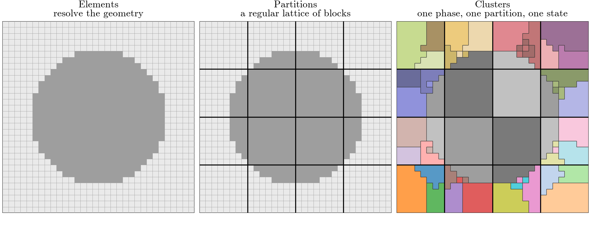
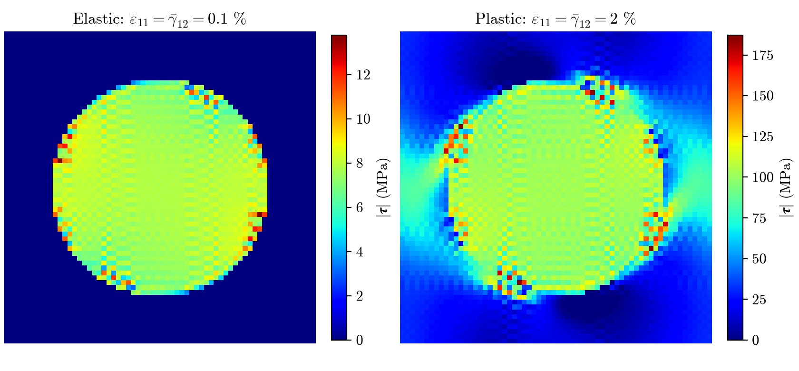
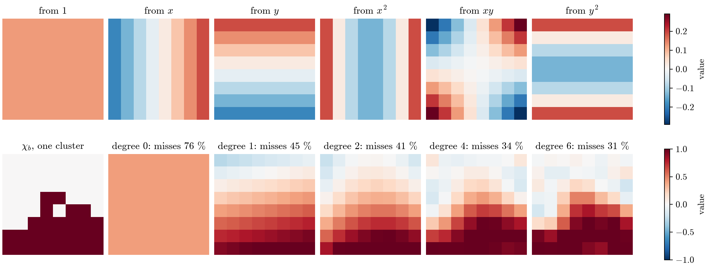
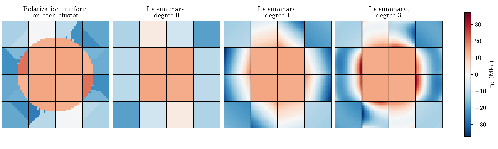
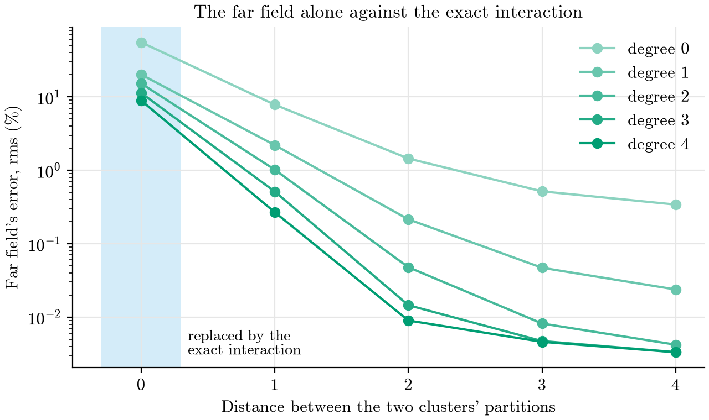

# FFT-TFA: the theory behind the code

**Goal.** Predict the stress–strain response of an elastoplastic composite with a handful of material states, as TFA
does, but compute how those states interact with an FFT on a coarse grid instead of with a dense matrix.

**Reason.** TFA's dense matrix makes memory and cost per iteration grow with the *square* of the number of material
states. An FFT on a grid of $N_{\text{part}}$ blocks costs $O(N_{\text{part}}\log N_{\text{part}})$ and stores
$O(N_{\text{part}})$, times a factor set by how finely each block is described (section 7), whatever the number of
material states inside the blocks. That is what lets the model be refined.

**How to read it.** Every derivation is written out one move at a time: each step says what it does (substitute,
rearrange, define, average) and then shows the result. Each section opens with its **Goal** and **Reason**. The
lecture assumes small-strain elasticity and knowing what an FFT does. The labels LS-\*, FT-\*, ER-\* are the ones the
code's comments cite, which is why they are not consecutive. Every figure is computed by the code
(`notes/figures/make_figures.py`). Papers are cited by author and year.

**Contents.** 1 The problem · 2 Three grids · 3 The Lippmann–Schwinger equation · 4 TFA through the LS equation ·
5 The matrix as reference medium · 6 The clustered equation · 7 A fast interaction (7.1 polynomials on a partition,
7.2 the far field, 7.3 the near field, 7.4 the result, 7.5 offline, 7.6 checks) · 8 Solving a load step · 9 The methods
side by side · 10 Known limits · Appendix: A the material law, B Spectral LS, C TFA, D the equations in the code,
E names in the code

### Notation

**Where things live.** One letter at three scales: element $\alpha$ lies in cluster $a$, which lies in partition $A$
(and $\beta$ in $b$ in $B$). So Greek $\alpha, \beta$ are **elements**, lowercase $a, b$ are **clusters**, and capital
$A, B$ are **partitions**. Every field is written as a function of where it lives: $\boldsymbol\varepsilon(\alpha)$ is
the strain of element $\alpha$, $\boldsymbol\varepsilon(a)$ the strain of cluster $a$.

**Two interaction symbols.** $\boldsymbol\Gamma_0(\alpha\leftarrow\beta)$ is the strain at element $\alpha$ per unit
polarization at element $\beta$, in the reference medium: the **element kernel**. A **hat** marks an average of it over
groups of elements: $\hat{\boldsymbol\Gamma}(a\leftarrow b)$ between clusters (section 6),
$\hat{\boldsymbol\Gamma}(A\leftarrow B)$ between partitions, and FFT-TFA's approximations
$\hat{\boldsymbol\Gamma}_{\text{far}}$, $\hat{\boldsymbol\Gamma}_{\text{corr}}$, $\hat{\boldsymbol\Gamma}_{\text{FFT-TFA}}$
(section 7).

**Labels.** A capital subscript is a name, not an index: $M$ matrix, $I$ inclusion, $T$ tangent; $0$ marks the
reference medium.

| Symbol | Meaning |
|---|---|
| $\boldsymbol\varepsilon,\ \boldsymbol\sigma$ | strain, stress: Voigt vectors $(\varepsilon_{11},\varepsilon_{22},\varepsilon_{33},2\varepsilon_{12},2\varepsilon_{23},2\varepsilon_{13})$ and $(\sigma_{11},\sigma_{22},\sigma_{33},\sigma_{12},\sigma_{23},\sigma_{13})$, so $\boldsymbol\sigma^{\mathsf T}\boldsymbol\varepsilon$ is the work (ER-2) |
| $\boldsymbol\mu$ | eigenstrain: here the plastic strain |
| $\boldsymbol\tau$ | polarization: the stress the reference medium gets wrong (section 3) |
| $\bar{\boldsymbol\varepsilon},\ \bar{\boldsymbol\sigma}$ | macro strain and macro stress: cell averages |
| $\mathbf L,\ \mathbf L_M,\ \mathbf L_I$ | elastic stiffness: local, of the matrix, of the inclusion |
| $\mathbf C_0,\ \mathbf L_T$ | stiffness of the reference medium; tangent stiffness $d\boldsymbol\sigma/d\boldsymbol\varepsilon$ |
| $\chi_a(\alpha)$ | indicator of cluster $a$: 1 if element $\alpha$ lies in $a$, else 0 |
| $\lvert a\rvert,\ \lvert A\rvert$ | number of elements of cluster $a$, of partition $A$ (the same for every partition) |
| $v(a)$ | volume fraction of cluster $a$ in its partition, $\lvert a\rvert/\lvert A\rvert$ |
| $\langle f\rangle_a$ | average over cluster $a$'s elements, $\frac1{\lvert a\rvert}\sum_{\alpha\text{ in }a}f(\alpha)$ |
| $\langle f\rangle$ | cell average; over clusters, $\frac1{N_{\text{part}}}\sum_a v(a)\,f(a)$ |
| $\varphi,\ \psi$ | polynomials on a partition (section 7.1): $\varphi$ at the target, $\psi$ at the source |
| $m(a,\varphi)$ | moment of cluster $a$ along $\varphi$ (section 7.1) |
| $N_{\text{elem}},\ N_{\text{part}},\ N_{\text{clust}},\ N_{\text{poly}}$ | numbers of elements, partitions, clusters, polynomials |

---

## 1. The problem

**Goal.** State what is solved: one periodic cell of a composite, loaded by a macro strain.

A composite: stiff elastic inclusions (fibers, a sphere, a layer) in a softer matrix that yields plastically. We study
one periodic cubic cell under a **macro strain** $\bar{\boldsymbol\varepsilon}$ that follows a load path, and want
the **macro stress** $\bar{\boldsymbol\sigma}=\langle\boldsymbol\sigma\rangle$ along it. In the cell:

$$
\large
\begin{aligned}
\text{material law:}\quad & \boldsymbol\sigma=\mathbf L\,(\boldsymbol\varepsilon-\boldsymbol\mu)\\[2pt]
\text{compatibility:}\quad & \boldsymbol\varepsilon=\bar{\boldsymbol\varepsilon}+\nabla^s\mathbf u,\qquad \mathbf u\ \text{periodic}\\[2pt]
\text{equilibrium:}\quad & \nabla\cdot\boldsymbol\sigma=\mathbf 0
\end{aligned}
$$

$\mathbf L$ is $\mathbf L_M$ in the matrix and $\mathbf L_I$ in the inclusion. The eigenstrain $\boldsymbol\mu$ is the
plastic strain, zero in the elastic inclusion.

**The material law is a black box** (`material.py`; the equations are in Appendix A).
At each load step, given a strain and the plastic history of the previous step, the radial return gives the plastic
strain and the stress, and its derivative gives the tangent:

$$
\large
\boldsymbol\varepsilon\ \longmapsto\ \boldsymbol\mu(\boldsymbol\varepsilon),\ \ \boldsymbol\sigma(\boldsymbol\varepsilon),
\qquad\qquad
\mathbf L_T=\frac{d\boldsymbol\sigma}{d\boldsymbol\varepsilon}=\mathbf L\Big(\mathbf I-\frac{d\boldsymbol\mu}{d\boldsymbol\varepsilon}\Big)
$$

The rest of the lecture is about the other half: how the material points interact through equilibrium.

**Why a reduced model.** A full-field solve has unknowns at every element, $10^4$–$10^6$ of them, at every Newton
iteration of every load step. A reduced model keeps a few material states instead.

---

## 2. Three grids

*Figure 1. The three grids on a fiber: 32² elements, 4² partitions, three matrix clusters per partition's matrix part.*

| Grid | What it is | What it decides |
|---|---|---|
| **Elements** $\alpha$ | a regular mesh that resolves the geometry; each element is matrix or inclusion (its **phase**) | geometry |
| **Partitions** $A$ | a regular lattice of blocks of $k\times k\times k$ elements ($k\times k$ columns if the geometry is constant through the thickness) | speed: they carry the FFT |
| **Clusters** $a$ | elements of one phase inside one partition, sharing **one material state**: one strain, stress and plastic strain | accuracy |

A partition holds one cluster per phase, or more, found by k-means on each element's elastic strain concentration
(`cell.cluster_by_k_means`, as in SCA: Liu–Bessa–Liu 2016, §2.2.1). Each cluster lies inside one partition: that is
what connects the two coarse grids. Spectral LS, the comparison method, is the case of one element per partition and
per cluster.

---

## 3. The Lippmann–Schwinger equation

**Goal.** Rewrite the cell problem as one equation for the strain, in which the heterogeneity appears only as a source.

**Reason.** In a heterogeneous body, how one point responds to another depends on everything around them. In a
*homogeneous* periodic body, it depends only on the vector between them: the response is a convolution, which an FFT
turns into a product.

#### Step 1 · Start from the three equations of section 1

$$
\large
\boldsymbol\sigma=\mathbf L\,(\boldsymbol\varepsilon-\boldsymbol\mu),
\qquad
\boldsymbol\varepsilon=\bar{\boldsymbol\varepsilon}+\nabla^s\mathbf u,
\qquad
\nabla\cdot\boldsymbol\sigma=\mathbf 0
$$

#### Step 2 · Define the polarization

Pick a homogeneous reference stiffness $\mathbf C_0$, the same everywhere. The **polarization** is the stress it gets
wrong:

$$
\large
\boldsymbol\tau=\boldsymbol\sigma-\mathbf C_0\,\boldsymbol\varepsilon
$$

#### Step 3 · Plug in the material law

$$
\large
\boldsymbol\tau=\mathbf L\,(\boldsymbol\varepsilon-\boldsymbol\mu)-\mathbf C_0\,\boldsymbol\varepsilon
$$

Collect the strain terms:

$$
\large
\boxed{\ \boldsymbol\tau=\underbrace{(\mathbf L-\mathbf C_0)\,\boldsymbol\varepsilon}_{\text{elastic contrast}}\ \underbrace{-\ \mathbf L\,\boldsymbol\mu}_{\text{plasticity}}\ }
\tag{LS-4}
$$

This is an identity, not an approximation.

#### Step 4 · Rewrite equilibrium with the polarization

From step 2, $\boldsymbol\sigma=\boldsymbol\tau+\mathbf C_0\boldsymbol\varepsilon$. Substitute into
$\nabla\cdot\boldsymbol\sigma=\mathbf 0$:

$$
\large
\nabla\cdot\big(\mathbf C_0\,\boldsymbol\varepsilon+\boldsymbol\tau\big)=\mathbf 0
$$

Move the polarization to the right-hand side:

$$
\large
\nabla\cdot\big(\mathbf C_0\,\boldsymbol\varepsilon\big)=-\nabla\cdot\boldsymbol\tau
$$

#### Step 5 · Plug in compatibility

Substitute $\boldsymbol\varepsilon=\bar{\boldsymbol\varepsilon}+\nabla^s\mathbf u$. The term
$\nabla\cdot(\mathbf C_0\bar{\boldsymbol\varepsilon})$ is zero, since $\mathbf C_0\bar{\boldsymbol\varepsilon}$ is
uniform:

$$
\large
\nabla\cdot\big(\mathbf C_0\,\nabla^s\mathbf u\big)=-\nabla\cdot\boldsymbol\tau
$$

This is the **homogeneous** medium $\mathbf C_0$, loaded by $\mathbf f=-\nabla\cdot\boldsymbol\tau$.

#### Step 6 · Solve the homogeneous problem with its Green operator

Let $\mathbf G_0$ be the periodic Green operator of $\mathbf C_0$: the periodic solution of
$\nabla\cdot(\mathbf C_0\nabla^s\mathbf u)=\mathbf f$ is $\mathbf u=\mathbf G_0[\mathbf f]$. Then

$$
\large
\mathbf u=\mathbf G_0\big[-\nabla\cdot\boldsymbol\tau\big]
$$

Plug this into compatibility, and pull the minus sign out:

$$
\large
\boldsymbol\varepsilon=\bar{\boldsymbol\varepsilon}-\nabla^s\mathbf G_0\big[\nabla\cdot\boldsymbol\tau\big]
$$

#### Step 7 · Define the Green operator for strain

Define, for any stress-like field $\mathbf v$,

$$
\large
\boldsymbol\Gamma_0[\mathbf v]=\nabla^s\mathbf G_0\big[\nabla\cdot\mathbf v\big]
$$

Then we have

$$
\large
\boxed{\ \boldsymbol\varepsilon=\bar{\boldsymbol\varepsilon}-\boldsymbol\Gamma_0[\boldsymbol\tau]\ }
\tag{LS-5}
$$

This is the **Lippmann–Schwinger equation** (Moulinec–Suquet 1998, eq. 7).

- It is **exact**, for any $\mathbf C_0$.
- It is an **equation**, not a formula: $\boldsymbol\tau$ depends on $\boldsymbol\varepsilon$ (LS-4). We solve it by
  Newton.
- $\boldsymbol\Gamma_0$ is a **convolution**, since the medium is homogeneous. In Fourier space it becomes one
  $6\times6$ matrix per frequency, known in closed form (Moulinec–Suquet 1998, eq. 4;
  `ls_model.get_moulinec_suquet_kernel`). At zero frequency it is zero: a uniform polarization causes no strain, which
  keeps $\langle\boldsymbol\varepsilon\rangle=\bar{\boldsymbol\varepsilon}$.

#### Step 8 · Write it on the elements

With $\boldsymbol\tau$ uniform on each element, $\boldsymbol\Gamma_0[\boldsymbol\tau]$ becomes a sum over elements:

$$
\large
\boldsymbol\varepsilon(\alpha)=\bar{\boldsymbol\varepsilon}-\sum_\beta\boldsymbol\Gamma_0(\alpha\leftarrow\beta)\,\boldsymbol\tau(\beta)
$$

$\boldsymbol\Gamma_0(\alpha\leftarrow\beta)$ is the element kernel: the strain at $\alpha$ per unit polarization on
$\beta$. It depends only on the offset from $\beta$ to $\alpha$, it is symmetric,
$\boldsymbol\Gamma_0(\alpha\leftarrow\beta)^{\mathsf T}=\boldsymbol\Gamma_0(\beta\leftarrow\alpha)$, and its sum over
all sources is zero. Applying it costs one FFT, a $6\times6$ product per frequency and one inverse FFT:
$O(N_{\text{elem}}\log N_{\text{elem}})$ (LS-17, `ls_model.apply_on_lattice`). Solving it with one material state per
element is **Spectral LS**, Moulinec–Suquet's method (`ls_model.SpectralLSSolver`; Appendix B).

---

## 4. TFA through the LS equation

**Goal.** Write TFA's equation with LS-5's operators, to see exactly where FFT-TFA will differ from it.

**Reason.** TFA keeps one material state per cluster: one eigenstrain $\boldsymbol\mu(b)$, updated at the cluster's
average strain $\boldsymbol\varepsilon(b)$. The strain itself still varies inside a cluster.

#### Step 1 · Start from LS-5 with LS-4

$$
\large
\boldsymbol\varepsilon=\bar{\boldsymbol\varepsilon}-\boldsymbol\Gamma_0\big[(\mathbf L-\mathbf C_0)\,\boldsymbol\varepsilon-\mathbf L\,\boldsymbol\mu\big]
$$

#### Step 2 · Move the strain term to the left-hand side

$\boldsymbol\Gamma_0$ is linear, so it splits over the two terms:

$$
\large
\boldsymbol\varepsilon+\boldsymbol\Gamma_0\big[(\mathbf L-\mathbf C_0)\,\boldsymbol\varepsilon\big]=\bar{\boldsymbol\varepsilon}+\boldsymbol\Gamma_0\big[\mathbf L\,\boldsymbol\mu\big]
$$

#### Step 3 · Define the operator on the left

$$
\large
\boldsymbol\Lambda_0[\mathbf v]=\mathbf v+\boldsymbol\Gamma_0\big[(\mathbf L-\mathbf C_0)\,\mathbf v\big]
\qquad\Longrightarrow\qquad
\boldsymbol\Lambda_0[\boldsymbol\varepsilon]=\bar{\boldsymbol\varepsilon}+\boldsymbol\Gamma_0\big[\mathbf L\,\boldsymbol\mu\big]
$$

#### Step 4 · Invert it

$\boldsymbol\Lambda_0$ is the LS operator of the elastic composite; assume it is invertible. Then

$$
\large
\boldsymbol\varepsilon=\boldsymbol\Lambda_0^{-1}\big[\bar{\boldsymbol\varepsilon}\big]+\boldsymbol\Lambda_0^{-1}\boldsymbol\Gamma_0\big[\mathbf L\,\boldsymbol\mu\big]
$$

#### Step 5 · Apply TFA's assumption: the eigenstrain is uniform on each cluster

$$
\large
\boldsymbol\mu(\alpha)=\sum_b\chi_b(\alpha)\,\boldsymbol\mu(b)
$$

Substitute, and pull the sum out of the linear operators:

$$
\large
\boldsymbol\varepsilon=\boldsymbol\Lambda_0^{-1}\big[\bar{\boldsymbol\varepsilon}\big]+\sum_b\boldsymbol\Lambda_0^{-1}\boldsymbol\Gamma_0\big[\mathbf L\,\chi_b\,\boldsymbol\mu(b)\big]
$$

#### Step 6 · Average over cluster $a$

$$
\large
\boxed{\ \boldsymbol\varepsilon(a)=\mathbf E(a)\,\bar{\boldsymbol\varepsilon}+\sum_b\mathbf P(a\leftarrow b)\,\boldsymbol\mu(b)\ }
\tag{ER-1}
$$

with the two influence tensors defined by what they do to any $\mathbf v$:

$$
\large
\mathbf E(a)\,\mathbf v=\big\langle\boldsymbol\Lambda_0^{-1}[\mathbf v]\big\rangle_a,
\qquad
\mathbf P(a\leftarrow b)\,\mathbf v=\big\langle\boldsymbol\Lambda_0^{-1}\boldsymbol\Gamma_0[\mathbf L\,\chi_b\,\mathbf v]\big\rangle_a
$$

This is TFA's equation (Fish–Cui 2026, eq. 8). The code computes $\mathbf E$ and $\mathbf P$ by finite elements,
the same quantities by another discretization, and solves it by Newton (Appendix C). Note the order: TFA **solves the equation at every point first**
(through $\boldsymbol\Lambda_0^{-1}$), **then averages** over the clusters.

**The cost.** $\mathbf P$ is **dense**: $(6N_{\text{clust}})^2$ numbers, every product touches all of them, and building
it takes $6N_{\text{clust}}$ solves of the full elastic problem. It cannot be a convolution:
$\boldsymbol\Lambda_0^{-1}$ is the heterogeneous composite's response, so moving a pair of clusters changes what lies
around them.

**FFT-TFA's plan:** keep TFA's material model (clusters, one eigenstrain each, updated at the cluster's average
strain), but **average first**: keep only $\boldsymbol\Gamma_0$, whose kernel is a convolution whatever the geometry,
and never form $\boldsymbol\Lambda_0^{-1}$. Sections 5 and 6 do this.

---

## 5. The key choice: the matrix as reference medium

**Goal.** Choose $\mathbf C_0$ so that each cluster's polarization is uniform, exactly where possible.

**Reason.** To average LS-5 over clusters (section 6), we want $\boldsymbol\tau$ uniform on each cluster. LS-4 shows
that $\boldsymbol\tau$ follows the strain wherever $\mathbf L\neq\mathbf C_0$, and the strain is not uniform on a
cluster.

#### Step 1 · Set $\mathbf C_0=\mathbf L_M$ in LS-4

$$
\large
\boldsymbol\tau=(\mathbf L-\mathbf L_M)\,\boldsymbol\varepsilon-\mathbf L\,\boldsymbol\mu
$$

#### Step 2 · Evaluate it in the matrix

There $\mathbf L=\mathbf L_M$, so the strain term cancels:

$$
\large
\boldsymbol\tau=(\mathbf L_M-\mathbf L_M)\,\boldsymbol\varepsilon-\mathbf L_M\,\boldsymbol\mu=-\mathbf L_M\,\boldsymbol\mu
$$

With one eigenstrain per cluster, this is **uniform on every matrix cluster, exactly**, whatever its shape.

#### Step 3 · Evaluate it in the inclusion

There $\mathbf L=\mathbf L_I$ and $\boldsymbol\mu=\mathbf 0$ (elastic):

$$
\large
\boldsymbol\tau=(\mathbf L_I-\mathbf L_M)\,\boldsymbol\varepsilon
$$

This follows the strain, which varies inside an inclusion cluster. **FFT-TFA takes it uniform on each cluster, at the
cluster's average strain**: the method's one approximation on the material side. (A yielding inclusion would add
$-\mathbf L_I\boldsymbol\mu$, uniform like the matrix's.)

*Figure 2. A fiber under $\bar\varepsilon_{11}$ and $\bar\gamma_{12}$ (Spectral LS on 64² elements,
$\boldsymbol\tau=\boldsymbol\sigma-\mathbf L_M\boldsymbol\varepsilon$). While elastic, the matrix has no polarization
at all; once it yields, its polarization is its plastic strain. The inclusion's polarization varies with its strain.
The speckle at the interface is the known ringing of the Moulinec–Suquet discretization.*

#### Result · Each cluster has one unknown, its strain $\boldsymbol\varepsilon(a)$

With $\mathbf L(a)$ the stiffness of its phase:

$$
\large
\boxed{\
\boldsymbol\tau(a)=\big(\mathbf L(a)-\mathbf L_M\big)\,\boldsymbol\varepsilon(a)-\mathbf L(a)\,\boldsymbol\mu(a),
\qquad
\boldsymbol\sigma(a)=\mathbf L(a)\big(\boldsymbol\varepsilon(a)-\boldsymbol\mu(a)\big)\ }
\tag{FT-1}
$$

with $\boldsymbol\mu(a)$ from the radial return at $\boldsymbol\varepsilon(a)$. With any other $\mathbf C_0$ the strain
term would appear in the matrix too, and the matrix would be approximated as well.

---

## 6. The clustered equation

**Goal.** Turn LS-5 into an equation for the cluster strains $\boldsymbol\varepsilon(a)$ alone.

**Reason.** Section 5 gives one polarization per cluster. LS-5 needs to be written for them.

#### Step 1 · Start from LS-5 on the elements

$$
\large
\boldsymbol\varepsilon(\alpha)=\bar{\boldsymbol\varepsilon}-\sum_\beta\boldsymbol\Gamma_0(\alpha\leftarrow\beta)\,\boldsymbol\tau(\beta)
$$

#### Step 2 · Apply the assumption: the polarization is uniform on each cluster

$$
\large
\boldsymbol\tau(\beta)=\sum_b\chi_b(\beta)\,\boldsymbol\tau(b)
$$

Substitute, and swap the two sums:

$$
\large
\boldsymbol\varepsilon(\alpha)=\bar{\boldsymbol\varepsilon}-\sum_b\Big(\sum_\beta\boldsymbol\Gamma_0(\alpha\leftarrow\beta)\,\chi_b(\beta)\Big)\boldsymbol\tau(b)
$$

#### Problem · The equation cannot hold at every element

The right-hand side varies from element to element inside a cluster $a$. But in an inclusion cluster
$\boldsymbol\tau(a)=(\mathbf L_I-\mathbf L_M)\,\boldsymbol\varepsilon$ was assumed uniform, so the strain should be
uniform too. A uniform polarization and the pointwise equation cannot both hold.

#### Solution · Require the equation only on average over each cluster

Average both sides over cluster $a$. The left-hand side becomes $\boldsymbol\varepsilon(a)$, the cluster's average
strain, which is also the strain FT-1 is evaluated at:

$$
\large
\boldsymbol\varepsilon(a)=\bar{\boldsymbol\varepsilon}-\sum_b\Big\langle\sum_\beta\boldsymbol\Gamma_0(\alpha\leftarrow\beta)\,\chi_b(\beta)\Big\rangle_a\boldsymbol\tau(b)
$$

#### Step 3 · Define the averaged kernel

Write the average over $a$ with $a$'s indicator, so that both clusters appear the same way:

$$
\large
\boxed{\
\hat{\boldsymbol\Gamma}(a\leftarrow b)=\frac1{\lvert a\rvert}\sum_\alpha\sum_\beta\chi_a(\alpha)\,\boldsymbol\Gamma_0(\alpha\leftarrow\beta)\,\chi_b(\beta)\ }
$$

the strain averaged over $a$ per unit polarization on $b$. Then we have

$$
\large
\boldsymbol\varepsilon(a)=\bar{\boldsymbol\varepsilon}-\sum_b\hat{\boldsymbol\Gamma}(a\leftarrow b)\,\boldsymbol\tau(b)
$$

This has the same form as LS-5, one level up: clusters instead of elements. It is SCA's clustered equation
(Liu–Bessa–Liu 2016, eqs. 16–17) with $\mathbf C_0=\mathbf L_M$.

**Two remarks.**

- **The same functions describe the unknown and test the equation:** the polarization is built from the indicators
  $\chi_b$, and the equation is averaged with the indicators $\chi_a$. This is a **Galerkin** approximation, as in
  Brisard–Dormieux (2012, §4.1–4.2), whose functions are constants on each cell. Section 7 keeps this structure.
- **Compare with TFA (section 4):** TFA solves the equation at every point and averages afterwards; here the equation
  is averaged before it is solved, and only $\boldsymbol\Gamma_0$ appears. Schneider (2019, §4) compares the two: they
  differ only in whether the Green operator is averaged over the clusters.

> **The problem.** $\hat{\boldsymbol\Gamma}(a\leftarrow b)$ is a dense table of $6\times6$ blocks, one per pair of
> clusters: no cheaper than TFA's $\mathbf P$. Section 7 is the actual idea of FFT-TFA.

---

## 7. A fast interaction: polynomial moments by FFT, exact inside each partition

**Goal.** Replace the dense table $\hat{\boldsymbol\Gamma}(a\leftarrow b)$ by something an FFT can apply, and that
becomes exact as one setting, the **degree**, is raised.

**Reason.** $\hat{\boldsymbol\Gamma}(a\leftarrow b)$ is not a convolution: the indicators $\chi_a$, $\chi_b$ have
different shapes in different partitions. Partitions, though, are translated copies of one block. If every cluster's
indicator is described by **the same few functions on every partition**, everything that depends on two partitions
depends only on their offset, and one FFT applies it.

**The plan.** 7.1 picks the functions: polynomials, orthonormal on a partition. 7.2 replaces each indicator in
$\hat{\boldsymbol\Gamma}(a\leftarrow b)$ by its polynomial approximation: the **far field**, by FFT. 7.3 restores the
exact interaction where polynomials fall short, between the clusters of one partition: the **near field**. 7.4 states
the result.

### 7.1 Polynomials on a partition

#### Step 1 · Define an inner product on a partition

For two functions $f, g$ on the elements of partition $A$:

$$
\large
(f,g)_A=\sum_{\alpha\text{ in }A}f(\alpha)\,g(\alpha),
\qquad
\lVert f\rVert_A=\sqrt{(f,f)_A}
$$

#### Step 2 · Start from the monomials in the element positions

Let $(x,y,z)$ be an element's position *inside its own partition*, measured from the partition's centre. The monomials
up to a total degree $d$ are

$$
\large
x^i\,y^j\,z^l,\qquad i+j+l\le d
$$

In 2D, degree 1 gives $1, x, y$; degree 2 adds $x^2, xy, y^2$. Their number $N_{\text{poly}}$ is 1, 3, 6, 10 for degrees
0–3 in 2D, and 1, 4, 10, 20 in 3D. Since positions are measured inside the partition, **every partition has the same
monomials**.

#### Step 3 · Make them orthonormal by Gram–Schmidt

Take the monomials in order of degree, constant first. For each, subtract its components along the polynomials already
made, then normalize:

$$
\large
\tilde\psi_n=x^{i_n}y^{j_n}z^{l_n}-\sum_{m<n}\big(x^{i_n}y^{j_n}z^{l_n},\,\psi_m\big)_A\,\psi_m,
\qquad
\psi_n=\frac{\tilde\psi_n}{\lVert\tilde\psi_n\rVert_A}
$$

The result is **orthonormal**:

$$
\large
(\varphi,\psi)_A=\begin{cases}1 & \varphi=\psi\\ 0 & \varphi\neq\psi\end{cases}
$$

The first polynomial is the constant, $1/\sqrt{\lvert A\rvert}$.

**How the code builds them.** Gram–Schmidt on the monomials loses the high degrees to round-off, since high powers of
positions inside a partition are nearly parallel. `fft_tfa_model.get_polynomial_basis` builds the same polynomials, up
to sign, as products of one orthonormal polynomial per axis (`get_axis_polynomials`, by a three-term recurrence). On a
grid such products are orthonormal, and each is its monomial plus terms of lower total degree, so it is the one unit
vector Gram–Schmidt could produce from that monomial.

**Example: one row of 4 elements.** Positions $x=-\tfrac32,-\tfrac12,\tfrac12,\tfrac32$. Gram–Schmidt gives, as values
at the four elements:

$$
\large
\begin{aligned}
\text{from }1:\quad & \psi_1=\tfrac12\,(1,\ 1,\ 1,\ 1)\\
\text{from }x:\quad & \psi_2=\tfrac1{\sqrt5}\,(-\tfrac32,\ -\tfrac12,\ \tfrac12,\ \tfrac32)\\
\text{from }x^2:\quad & x^2-\tfrac54=(1,-1,-1,1)\ \ \Rightarrow\ \ \psi_3=\tfrac12\,(1,\ -1,\ -1,\ 1)\\
\text{from }x^3:\quad & x^3-\tfrac{41}{20}x=\tfrac3{10}(-1,3,-3,1)\ \ \Rightarrow\ \ \psi_4=\tfrac1{\sqrt{20}}\,(-1,\ 3,\ -3,\ 1)
\end{aligned}
$$

(for $x^2$, the component along $\psi_1$ is $\tfrac54\cdot2$ and along $\psi_2$ zero by symmetry; for $x^3$, the component
along $\psi_2$ is $\tfrac{41}{4}/\sqrt5$). Four polynomials on four elements: they span every function there.

*Figure 3. Top: the six orthonormal polynomials of degree at most 2 on a partition of 8 × 8 elements, each labelled by
the monomial it comes from. Bottom: the indicator $\chi_b$ of one matrix cluster in a partition the fiber's edge
crosses, and its projection $\Pi_d\chi_b$ (step 5) at increasing degree, with the share of $\lVert\chi_b\rVert_A$ it
misses. The projection follows the cluster's shape more closely with each degree; a step needs many polynomials.*

#### Step 4 · Define the moments of a function

The **moment** of $f$ along polynomial $\psi$ is its inner product with it:

$$
\large
f(B,\psi)=(f,\psi)_B=\sum_{\beta\text{ in }B}\psi(\beta)\,f(\beta)
$$

For a cluster's indicator, it is the polynomial summed over the cluster's elements. This number, fixed by the geometry
and computed once, is the **cluster's moment** (`fft_tfa_model.get_cluster_moments`):

$$
\large
m(b,\psi)=(\chi_b,\psi)_B=\sum_{\beta\text{ in }b}\psi(\beta)
$$

#### Step 5 · Why orthonormal: the moments are the best fit's coefficients

**Claim.** Among all polynomials of degree at most $d$, the one closest to $f$ on $B$ (least squares) is

$$
\large
\Pi_d f=\sum_\psi f(B,\psi)\,\psi
$$

**Proof.** Write a candidate as $\sum_\psi c_\psi\,\psi$ and expand the squared error with the inner product:

$$
\large
\Big\lVert f-\sum_\psi c_\psi\psi\Big\rVert_B^2
=\lVert f\rVert_B^2-2\sum_\psi c_\psi\,(f,\psi)_B+\sum_\varphi\sum_\psi c_\varphi c_\psi\,(\varphi,\psi)_B
$$

Orthonormality turns the double sum into $\sum_\psi c_\psi^2$. Complete the square:

$$
\large
\Big\lVert f-\sum_\psi c_\psi\psi\Big\rVert_B^2=\lVert f\rVert_B^2-\sum_\psi f(B,\psi)^2+\sum_\psi\big(c_\psi-f(B,\psi)\big)^2
$$

The last sum is the only one that depends on the $c_\psi$, and it is smallest, zero, at $c_\psi=f(B,\psi)$. $\square$

What this buys, read off the last equation:

1. **No system to solve.** Without orthonormality the best fit needs the normal equations, a $N_{\text{poly}}\times
   N_{\text{poly}}$ solve per partition. With it, each coefficient is one inner product, computed on its own.
2. **Raising the degree never undoes the lower ones.** Adding polynomials leaves every earlier coefficient as it was.
   The squared error of the best fit is $\lVert f\rVert_B^2-\sum_\psi f(B,\psi)^2$: it can only fall as polynomials are
   added (figure 3, bottom).
3. **At full degree the fit is exact.** With $k$ elements per partition side, the monomials up to power $k-1$ in each
   coordinate span every function on a partition's elements (as in the example); their total degree is $2(k-1)$ in 2D,
   $3(k-1)$ in 3D (`degree = "full"`). Then $\Pi_d f=f$ for every $f$.
4. **Uniform fields are exact at every degree.** The constant is one of the polynomials, so $\Pi_d$ of a uniform field
   is that field. This matters in 7.3.
5. **The same on every partition.** The polynomials, and so the cluster moments' definition, are the same in every
   partition. This is what makes 7.2 a convolution.

**In the example.** A cluster covering the left half of the row, $\chi_b=(1,1,0,0)$, has moments $m(b,\psi_1)=1$,
$m(b,\psi_2)=-2/\sqrt5$, $m(b,\psi_3)=0$, $m(b,\psi_4)=2/\sqrt{20}$. Its projections:

$$
\large
\begin{aligned}
\Pi_0\chi_b&=(0.5,\ 0.5,\ 0.5,\ 0.5) && \text{squared error }\ 2-1=1\\
\Pi_1\chi_b=\Pi_2\chi_b&=(1.1,\ 0.7,\ 0.3,\ -0.1) && \text{squared error }\ 2-1-0.8=0.2\\
\Pi_3\chi_b&=(1,\ 1,\ 0,\ 0) && \text{squared error }\ 0
\end{aligned}
$$

### 7.2 The far field: approximate the indicators by polynomials

#### Step 1 · Start from the averaged kernel of section 6

$$
\large
\hat{\boldsymbol\Gamma}(a\leftarrow b)=\frac1{\lvert a\rvert}\sum_\alpha\sum_\beta\chi_a(\alpha)\,\boldsymbol\Gamma_0(\alpha\leftarrow\beta)\,\chi_b(\beta)
$$

#### Step 2 · Approximate both indicators by their projections on their own partitions

Cluster $b$ lies in partition $B$ and $a$ in $A$. By 7.1 step 5:

$$
\large
\begin{aligned}
\chi_b(\beta)&\approx\Pi_d\chi_b(\beta)=\sum_\psi m(b,\psi)\,\psi(\beta) && (\beta\text{ in }B)\\[4pt]
\chi_a(\alpha)&\approx\Pi_d\chi_a(\alpha)=\sum_\varphi m(a,\varphi)\,\varphi(\alpha) && (\alpha\text{ in }A)
\end{aligned}
$$

Each projection lives on its own partition only. Substitute both:

$$
\large
\hat{\boldsymbol\Gamma}(a\leftarrow b)\approx\frac1{\lvert a\rvert}\sum_{\alpha\text{ in }A}\ \sum_{\beta\text{ in }B}\Big(\sum_\varphi m(a,\varphi)\,\varphi(\alpha)\Big)\boldsymbol\Gamma_0(\alpha\leftarrow\beta)\Big(\sum_\psi m(b,\psi)\,\psi(\beta)\Big)
$$

#### Step 3 · Pull the sums over polynomials out

The moments do not depend on $\alpha$ or $\beta$:

$$
\large
\hat{\boldsymbol\Gamma}(a\leftarrow b)\approx\sum_\varphi\sum_\psi\frac{m(a,\varphi)}{\lvert a\rvert}\Big(\sum_{\alpha\text{ in }A}\ \sum_{\beta\text{ in }B}\varphi(\alpha)\,\boldsymbol\Gamma_0(\alpha\leftarrow\beta)\,\psi(\beta)\Big)m(b,\psi)
$$

#### Step 4 · Define the moment kernel

The bracket depends on the two partitions and the two polynomials, not on the clusters:

$$
\large
\mathbf K(A,\varphi\leftarrow B,\psi)=\sum_{\alpha\text{ in }A}\ \sum_{\beta\text{ in }B}\varphi(\alpha)\,\boldsymbol\Gamma_0(\alpha\leftarrow\beta)\,\psi(\beta)
$$

the strain in $A$ along $\varphi$ per unit polarization in $B$ along $\psi$. Then we have the **far field**:

$$
\large
\boxed{\
\hat{\boldsymbol\Gamma}_{\text{far}}(a\leftarrow b)=\sum_\varphi\sum_\psi\frac{m(a,\varphi)}{\lvert a\rvert}\,\mathbf K(A,\varphi\leftarrow B,\psi)\,m(b,\psi)\ }
\tag{FT-2}
$$

#### Step 5 · Apply it to the polarization: the moments of $\boldsymbol\tau$ appear

$$
\large
\sum_b\hat{\boldsymbol\Gamma}_{\text{far}}(a\leftarrow b)\,\boldsymbol\tau(b)
=\sum_\varphi\frac{m(a,\varphi)}{\lvert a\rvert}\sum_B\sum_\psi\mathbf K(A,\varphi\leftarrow B,\psi)\Big(\sum_{b\text{ in }B}m(b,\psi)\,\boldsymbol\tau(b)\Big)
$$

The bracket is the moment of the polarization field of 6 step 2, $\boldsymbol\tau=\sum_b\chi_b\boldsymbol\tau(b)$, since
the moment is linear:

$$
\large
\boldsymbol\tau(B,\psi)=\sum_{b\text{ in }B}m(b,\psi)\,\boldsymbol\tau(b)=\sum_{\beta\text{ in }B}\psi(\beta)\,\boldsymbol\tau(\beta)
$$

So **approximating the indicators is the same as approximating the polarization** by its best-fitting polynomial on
each partition, $\Pi_d\boldsymbol\tau=\sum_\psi\boldsymbol\tau(B,\psi)\,\psi$: its **summary** (figure 4).

*Figure 4. FFT-TFA's polarization, its shear component, at the end of the load of figure 2 (4² partitions, two matrix
clusters per partition's matrix part, solved at degree 1), and each partition's summary $\Pi_d\boldsymbol\tau$. Degree 0
keeps each partition's mean, higher degrees follow the field across it. A step at the fiber's edge needs many
polynomials: at degree 3 the summary still overshoots there.*

#### Step 6 · Why approximate the target's indicator too

Approximating only $\chi_b$ would leave $\langle\boldsymbol\Gamma_0[\Pi_d\boldsymbol\tau]\rangle_a$: the strain caused
by the summaries, needed at every element to average it over $a$. That is an FFT on the elements, the cost we avoid.
Approximating $\chi_a$ the same way needs only the moments of that strain along each $\varphi$, which is what
$\mathbf K$ gives. It is the Galerkin structure of section 6 again, with polynomials in place of indicators: the same
functions describe the polarization and test the equation. It keeps a property of the exact kernel: since
$\boldsymbol\Gamma_0$ is symmetric, $\mathbf K(A,\varphi\leftarrow B,\psi)^{\mathsf T}=\mathbf K(B,\psi\leftarrow A,\varphi)$,
and $\lvert a\rvert\,\hat{\boldsymbol\Gamma}_{\text{far}}(a\leftarrow b)$ is the transpose of
$\lvert b\rvert\,\hat{\boldsymbol\Gamma}_{\text{far}}(b\leftarrow a)$, as for $\hat{\boldsymbol\Gamma}$.

#### Step 7 · The moment kernel is a convolution on the partitions

Write the element positions as partition plus position inside it: $\alpha$ at $k\,A+\mathbf r$ and $\beta$ at
$k\,B+\mathbf s$, with $k$ elements per partition side. The element kernel depends only on the offset:

$$
\large
\boldsymbol\Gamma_0(\alpha\leftarrow\beta)=\boldsymbol\Gamma_0\big(k(A-B)+\mathbf r-\mathbf s\big)
$$

and $\varphi$, $\psi$ depend only on $\mathbf r$, $\mathbf s$, the same in every partition. Substitute into
$\mathbf K$:

$$
\large
\mathbf K(A,\varphi\leftarrow B,\psi)=\sum_{\mathbf r}\sum_{\mathbf s}\varphi(\mathbf r)\,\boldsymbol\Gamma_0\big(k(A-B)+\mathbf r-\mathbf s\big)\,\psi(\mathbf s)
$$

It depends on $A$ and $B$ only through their offset $\mathbf D=A-B$, so the sum over $B$ in step 5 is a **convolution on
the partition lattice**. The far field is then three stages (`fft_tfa_model.get_strain_change`):

1. **Summarize:** every partition's moments $\boldsymbol\tau(B,\psi)$, from the cluster polarizations;
2. **Interact:** one FFT of the moments, one $6N_{\text{poly}}\times6N_{\text{poly}}$ product with $\mathbf K$ per
   frequency, one inverse FFT (`ls_model.apply_on_lattice`). This gives, for every partition $A$ and polynomial
   $\varphi$, $\sum_B\sum_\psi\mathbf K(A,\varphi\leftarrow B,\psi)\,\boldsymbol\tau(B,\psi)$: the moments along
   $\varphi$ of the strain the summaries cause;
3. **Read back:** cluster $a$ weights its partition's moments by $m(a,\varphi)/\lvert a\rvert$.

$\hat{\boldsymbol\Gamma}_{\text{far}}(a\leftarrow b)$ is never formed. It names, pair by pair, what these three stages
compute.

### 7.3 The near field: exact inside each partition

#### Step 1 · Measure the far field against the exact kernel

*Figure 5. $\hat{\boldsymbol\Gamma}_{\text{far}}(a\leftarrow b)$ against $\hat{\boldsymbol\Gamma}(a\leftarrow b)$,
pair by pair: a fiber on 64² elements, 8² partitions, two matrix clusters per partition's matrix part. The error is a
volume-weighted rms over all cluster pairs at each distance, as a share of the exact interaction within a partition.*

Between partitions, the far field converges with the degree: one partition apart it is 8 % off at degree 0 and 0.3 % at
degree 4. Within a partition it is not good enough: 54 % off at degree 0, still 9 % at degree 4. There the kernel is at
its sharpest and the indicators step at every interface, and polynomials follow neither (figures 3 and 4).

#### Step 2 · Define the correction: what the far field misses

For every pair of clusters,

$$
\large
\hat{\boldsymbol\Gamma}_{\text{corr}}(a\leftarrow b)=\hat{\boldsymbol\Gamma}(a\leftarrow b)-\hat{\boldsymbol\Gamma}_{\text{far}}(a\leftarrow b)
\tag{FT-3}
$$

so that, exactly,

$$
\large
\sum_b\hat{\boldsymbol\Gamma}(a\leftarrow b)\,\boldsymbol\tau(b)=\sum_b\hat{\boldsymbol\Gamma}_{\text{far}}(a\leftarrow b)\,\boldsymbol\tau(b)+\sum_b\hat{\boldsymbol\Gamma}_{\text{corr}}(a\leftarrow b)\,\boldsymbol\tau(b)
$$

#### Step 3 · Show that the corrections of a uniform polarization add up to zero

Sum the exact kernel over **all** sources $b$. The indicators add up to 1 everywhere, $\sum_b\chi_b=1$, so

$$
\large
\sum_b\hat{\boldsymbol\Gamma}(a\leftarrow b)=\frac1{\lvert a\rvert}\sum_\alpha\chi_a(\alpha)\sum_\beta\boldsymbol\Gamma_0(\alpha\leftarrow\beta)=\mathbf 0
$$

since the element kernel sums to zero over its sources (section 3: a uniform polarization causes no strain). The far
field does the same: summed over the clusters of $B$, the moments are those of $\chi_B=1$ on $B$, which only the constant
polynomial sees (7.1, point 4), and the constant moment of every partition gives a uniform polarization, which
$\boldsymbol\Gamma_0$ turns into zero. So $\sum_b\hat{\boldsymbol\Gamma}_{\text{far}}(a\leftarrow b)=\mathbf 0$, and
subtracting:

$$
\large
\sum_b\hat{\boldsymbol\Gamma}_{\text{corr}}(a\leftarrow b)=\mathbf 0\qquad\text{(over all clusters }b\text{, in every partition)}
$$

#### Step 4 · Rewrite the corrections on the polarization's deviation from its mean

Split $\boldsymbol\tau(b)=\langle\boldsymbol\tau\rangle+\big(\boldsymbol\tau(b)-\langle\boldsymbol\tau\rangle\big)$,
with $\langle\boldsymbol\tau\rangle=\frac1{N_{\text{part}}}\sum_bv(b)\,\boldsymbol\tau(b)$ the cell mean. By step 3 the
mean drops out:

$$
\large
\sum_b\hat{\boldsymbol\Gamma}_{\text{corr}}(a\leftarrow b)\,\boldsymbol\tau(b)=\underbrace{\Big(\sum_b\hat{\boldsymbol\Gamma}_{\text{corr}}(a\leftarrow b)\Big)}_{=\ \mathbf 0}\langle\boldsymbol\tau\rangle+\sum_b\hat{\boldsymbol\Gamma}_{\text{corr}}(a\leftarrow b)\,\big(\boldsymbol\tau(b)-\langle\boldsymbol\tau\rangle\big)
$$

Still exact. Nothing has been dropped yet.

#### Step 5 · Approximate: keep the corrections inside each partition only

Drop the corrections between clusters of different partitions, where the far field is already accurate (step 1):

$$
\large
\sum_b\hat{\boldsymbol\Gamma}_{\text{corr}}(a\leftarrow b)\,\big(\boldsymbol\tau(b)-\langle\boldsymbol\tau\rangle\big)\ \approx\sum_{b\text{ in }A}\hat{\boldsymbol\Gamma}_{\text{corr}}(a\leftarrow b)\,\big(\boldsymbol\tau(b)-\langle\boldsymbol\tau\rangle\big)
$$

This is FFT-TFA's one approximation of the interaction, and the degree controls what it drops.

**Why step 4 comes before step 5.** The corrections of one partition do **not** add up to zero: only their sum over all
partitions does. Truncated without step 4, a uniform polarization would cause a strain through the corrections kept,
which the exact equation forbids. Truncated after step 4, a uniform polarization reaches the corrections as zero, and
causes no strain at every degree: the **patch test**, passed by construction.

#### Step 6 · Keep the mean strain

The exact kernel changes no cell average: by the same argument as step 3, summed over all **targets** $a$ with weights
$v(a)$, $\hat{\boldsymbol\Gamma}(a\leftarrow b)$ adds up to zero, so $\langle\boldsymbol\varepsilon\rangle=
\bar{\boldsymbol\varepsilon}$. The far field keeps this; the corrections kept in step 5 do not quite. So subtract the
cell mean of the interaction from each cluster's. For the exact kernel this subtracts zero.

### 7.4 The result: FFT-TFA's interaction

Assemble 7.2 (far field) and 7.3 steps 5 and 6 (near field, cell mean). Define, for every cluster,

$$
\large
\boxed{\
\begin{aligned}
\boldsymbol\varepsilon(a)&=\bar{\boldsymbol\varepsilon}-\big(\hat{\boldsymbol\Gamma}_{\text{FFT-TFA}}\boldsymbol\tau\big)(a)\\[6pt]
\big(\hat{\boldsymbol\Gamma}_{\text{FFT-TFA}}\boldsymbol\tau\big)(a)&=\underbrace{\sum_b\hat{\boldsymbol\Gamma}_{\text{far}}(a\leftarrow b)\,\boldsymbol\tau(b)}_{\text{far field, by FFT}}
\ +\underbrace{\sum_{b\text{ in }A}\hat{\boldsymbol\Gamma}_{\text{corr}}(a\leftarrow b)\,\big(\boldsymbol\tau(b)-\langle\boldsymbol\tau\rangle\big)}_{\text{near field, in }a\text{'s partition}}\\[4pt]
&\qquad-\ \big\langle\,\text{the same two terms}\,\big\rangle
\end{aligned}\ }
\tag{FT-4}
$$

$\hat{\boldsymbol\Gamma}_{\text{FFT-TFA}}$ is FFT-TFA's approximation of the clustered equation's
$\hat{\boldsymbol\Gamma}$ (`fft_tfa_model.get_strain_change`). It is linear in $\boldsymbol\tau$: the two means are
linear too.

### 7.5 Computing it offline (`fft_tfa_model.get_interaction`, once)

Both tables are sums of the element kernel, which depends only on the offset between two elements. For $\alpha$ in $A$
and $\beta$ in $B$:

$$
\large
\text{offset from }\beta\text{ to }\alpha\;=\;k\,\mathbf D+\boldsymbol\delta,
\qquad
\begin{aligned}
\mathbf D&=A-B,\ \text{in partitions}\\
\boldsymbol\delta&=\mathbf r-\mathbf s,\ \text{in elements}
\end{aligned}
$$

$\boldsymbol\delta$ is the offset between the two elements' positions inside their partitions.

**The moment kernels.** In 7.2 step 7, group the pairs of positions by $\boldsymbol\delta$:

$$
\large
\mathbf K(\mathbf D,\varphi\leftarrow\psi)=\sum_{\boldsymbol\delta}w(\varphi,\psi,\boldsymbol\delta)\ \boldsymbol\Gamma_0\big(k\mathbf D+\boldsymbol\delta\big),
\qquad
w(\varphi,\psi,\boldsymbol\delta)=\sum_{\mathbf r-\mathbf s=\boldsymbol\delta}\varphi(\mathbf r)\,\psi(\mathbf s)
$$

for every offset $\mathbf D$ at once (`get_moment_kernels`), then transformed to Fourier space.

**The corrections.** Inside one partition ($\mathbf D=\mathbf 0$), group the element pairs of section 6 step 3 the same
way:

$$
\large
\hat{\boldsymbol\Gamma}(a\leftarrow b)=\frac{1}{\lvert a\rvert}\sum_{\boldsymbol\delta}\text{pairs}(a,b,\boldsymbol\delta)\ \boldsymbol\Gamma_0(\boldsymbol\delta)
$$

$\text{pairs}(a,b,\boldsymbol\delta)$ counts the element pairs of $a$ and $b$ with offset $\boldsymbol\delta$; for every
offset at once, that is the cross-correlation of the two clusters' indicators, one FFT padded to twice the partition.
Subtracting FT-2's share gives FT-3 (`get_correction_blocks`).

**Memory.** The moment kernels hold one $6N_{\text{poly}}\times6N_{\text{poly}}$ block per frequency of the partition
grid, the corrections one $6\times6$ block per pair of clusters in the same partition. The kernels grow with
$N_{\text{poly}}^2$, not with the clusters: in 3D, degree 3 stores 25 times as much as degree 1.

### 7.6 Three checks of the derivation

- **Degree 0.** The one polynomial is the constant $1/\sqrt{\lvert A\rvert}$, so $m(b,1)=\lvert b\rvert/\sqrt{\lvert
  A\rvert}$ and $m(a,1)/\lvert a\rvert=1/\sqrt{\lvert A\rvert}$. Substitute into FT-2:

  $$
  \large
  \begin{aligned}
  \hat{\boldsymbol\Gamma}_{\text{far}}(a\leftarrow b)
  &=\frac{1}{\sqrt{\lvert A\rvert}}\Big(\sum_{\alpha\text{ in }A}\ \sum_{\beta\text{ in }B}\frac{1}{\sqrt{\lvert A\rvert}}\,\boldsymbol\Gamma_0(\alpha\leftarrow\beta)\,\frac{1}{\sqrt{\lvert A\rvert}}\Big)\frac{\lvert b\rvert}{\sqrt{\lvert A\rvert}}\\[4pt]
  &=\frac{\lvert b\rvert}{\lvert A\rvert}\cdot\frac{1}{\lvert A\rvert}\sum_{\alpha\text{ in }A}\ \sum_{\beta\text{ in }B}\boldsymbol\Gamma_0(\alpha\leftarrow\beta)
  \;=\;v(b)\,\hat{\boldsymbol\Gamma}(A\leftarrow B)
  \end{aligned}
  $$

  with $\hat{\boldsymbol\Gamma}(A\leftarrow B)$ section 6's average one level up, over partitions: each partition acts
  through its mean polarization, like Brisard and Dormieux's cells (2010, §3.2).
- **Full degree.** The projections are exact (7.1, point 3): $\Pi_d\chi_b=\chi_b$, so
  $\hat{\boldsymbol\Gamma}_{\text{far}}=\hat{\boldsymbol\Gamma}$, the corrections vanish, and FT-4 is the exact clustered
  equation of section 6. `check.py` confirms this to round-off on every problem (`get_interaction_error`), and that a
  uniform polarization causes no strain at the problem's degree (`get_patch_test_error`).
- **One element per partition.** Every degree is full, and FFT-TFA is Spectral LS with $\mathbf C_0=\mathbf L_M$.

---

## 8. Solving a load step

**Goal.** Find the cluster strains that satisfy FT-4 with FT-1, at each load step.

**Reason.** $\boldsymbol\tau$ depends on $\boldsymbol\varepsilon$ through the material law, so FT-4 is nonlinear.
Newton's method needs a residual, the linear system for a correction, and a preconditioner for that system.

#### Step 1 · Define the residual

Move everything in FT-4 to one side:

$$
\large
\mathbf r(\boldsymbol\varepsilon)=\boldsymbol\varepsilon-\bar{\boldsymbol\varepsilon}+\hat{\boldsymbol\Gamma}_{\text{FFT-TFA}}\,\boldsymbol\tau(\boldsymbol\varepsilon)
\tag{FT-5}
$$

with $\boldsymbol\tau(\boldsymbol\varepsilon)$ from FT-1, cluster by cluster. The strains solve the step when
$\mathbf r=\mathbf 0$.

#### Step 2 · Linearize it

Change the strains by $\delta\boldsymbol\varepsilon$. To first order, the polarization changes by its derivative:

$$
\large
\boldsymbol\tau(\boldsymbol\varepsilon+\delta\boldsymbol\varepsilon)\approx\boldsymbol\tau(\boldsymbol\varepsilon)+\frac{d\boldsymbol\tau}{d\boldsymbol\varepsilon}\,\delta\boldsymbol\varepsilon
$$

From $\boldsymbol\tau=\boldsymbol\sigma-\mathbf L_M\boldsymbol\varepsilon$ and $d\boldsymbol\sigma/d\boldsymbol\varepsilon=\mathbf L_T$:

$$
\large
\frac{d\boldsymbol\tau(a)}{d\boldsymbol\varepsilon(a)}=\mathbf L_T(a)-\mathbf L_M
$$

how each cluster's polarization changes with its own strain. $\hat{\boldsymbol\Gamma}_{\text{FFT-TFA}}$ is linear, so

$$
\large
\mathbf r(\boldsymbol\varepsilon+\delta\boldsymbol\varepsilon)\approx\mathbf r(\boldsymbol\varepsilon)+\delta\boldsymbol\varepsilon+\hat{\boldsymbol\Gamma}_{\text{FFT-TFA}}\,(\mathbf L_T-\mathbf L_M)\,\delta\boldsymbol\varepsilon
$$

#### Step 3 · Set the linearized residual to zero

$$
\large
\delta\boldsymbol\varepsilon+\hat{\boldsymbol\Gamma}_{\text{FFT-TFA}}\,(\mathbf L_T-\mathbf L_M)\,\delta\boldsymbol\varepsilon=-\mathbf r
\tag{FT-6}
$$

The system is never assembled: each product with its left-hand side is one FFT on the partitions and one sparse product
for the corrections. It is not symmetric, so GMRES solves it.

#### Step 4 · Precondition with each cluster's own block

The left-hand side's $6\times6$ block from a cluster to itself is

$$
\large
\mathbf I+\hat{\boldsymbol\Gamma}_{\text{FFT-TFA}}(a\leftarrow a)\,\big(\mathbf L_T(a)-\mathbf L_M\big)
\tag{FT-7}
$$

Inverting these blocks (block-Jacobi) cuts GMRES's iterations. $\hat{\boldsymbol\Gamma}_{\text{FFT-TFA}}(a\leftarrow a)$
is each cluster's effect on itself: the far field's self-term, the cluster's own correction, less what the two cell
means of FT-4 take back. They are built once (`fft_tfa_model.get_own_strain_change`).

**Convergence** is judged on FT-5 directly. It is a strain error, like TFA's, and with $\mathbf C_0=\mathbf L_M$ it is
already the "matrix units" measure that Spectral LS has to compute (LS-24, Appendix B.3).

**One load step** (`newton.Solver.solve_step`):

1. Start from the previous strains plus the macro strain increment.
2. Evaluate FT-1 and FT-5.
3. Solve FT-6 for $\delta\boldsymbol\varepsilon$ by GMRES, and step with a backtracking line search.
4. Repeat until the relative residual is below `convergence_tolerance`, then accept the plastic history.

---

## 9. The methods side by side

| | Material states | Uniform per state | Interaction | Stored | Cost per product |
|-------|------|-------|---------|---------|------------|
| **FFT-TFA** | clusters | $\boldsymbol\mu$, $\boldsymbol\varepsilon$ | polynomial moments by partition FFT + exact inside each partition | moment kernels on the partitions + blocks inside each partition | $O(N_{\text{poly}}N_{\text{part}}\log N_{\text{part}})$ + $O(N_{\text{poly}}^2N_{\text{part}})$ + blocks |
| **Spectral LS** | elements | everything | element FFT | kernel and fields on the elements | $O(N_{\text{elem}}\log N_{\text{elem}})$ |
| **TFA** | clusters | $\boldsymbol\mu$ | exact FE influence functions | dense, $(6N_{\text{clust}})^2$ | $O(N_{\text{clust}}^2)$ |
| SCA (not in the code) | clusters | $\boldsymbol\mu$, $\boldsymbol\varepsilon$ | clustered LS operator | dense, $(6N_{\text{clust}})^2$ | $O(N_{\text{clust}}^2)$ |

**TFA and FFT-TFA, equation by equation.**

| | TFA (section 4) | FFT-TFA (sections 5–7) |
|---|---|---|
| Unknowns | $\boldsymbol\varepsilon(a)$ | $\boldsymbol\varepsilon(a)$ |
| Uniform per cluster | $\boldsymbol\mu$ | $\boldsymbol\mu$, and $\boldsymbol\tau$ (exact in the matrix) |
| Equation | $\boldsymbol\varepsilon(a)=\mathbf E(a)\,\bar{\boldsymbol\varepsilon}+\sum_b\mathbf P(a\leftarrow b)\,\boldsymbol\mu(b)$ | $\boldsymbol\varepsilon(a)=\bar{\boldsymbol\varepsilon}-\big(\hat{\boldsymbol\Gamma}_{\text{FFT-TFA}}\boldsymbol\tau\big)(a)$ |
| Order | solve at every point, then average | average, then solve |
| Operator | $\boldsymbol\Lambda_0^{-1}$: the composite's response | $\boldsymbol\Gamma_0$: the matrix's, a convolution |

**Where FFT-TFA's error against TFA on the same clusters comes from.** It has three parts, each measurable with the
code:

1. the inclusion's polarization taken uniform per cluster (FFT-TFA at full degree against TFA);
2. the far field's polynomial summary (FFT-TFA against itself at full degree);
3. the Moulinec–Suquet kernel against TFA's finite elements.

**Relation to the literature.**

- **Moulinec–Suquet (1998):** the reference-medium equation and its FFT solution.
- **SCA (Liu–Bessa–Liu 2016):** the clustered equation, with $\hat{\boldsymbol\Gamma}(a\leftarrow b)$ built as a dense
  matrix on the fine grid (their eq. 27). They found a reference medium equal to the matrix too stiff once the matrix
  yields (§3.2, Fig. 5), and update it self-consistently at every increment. FFT-TFA keeps $\mathbf L_M$ fixed, which
  makes the matrix's polarization exact (section 5) and leaves one kernel, built once.
- **Brisard–Dormieux (2010, 2012):** the same regular cells, in linear elasticity, with a polarization constant on each
  cell, used both to approximate the polarization and to test the equation (2012, §4.1–4.2). FFT-TFA's far field uses
  polynomials up to a degree in place of constants, and adds clusters inside the cells, with the exact interaction
  among a cell's own clusters.
- **Zhang et al. (2019, §2.3):** cluster interactions on a uniform coarse grid too, by cell-to-cell integrals with the
  cross terms inside a cell set to zero, assembled into a dense matrix, with neither FFT nor corrections.
- Whether polynomial moments on an FFT grid appear elsewhere, for instance in fast methods for integral equations, is
  not yet checked.

---

## 10. Known limits

#### The far field converges with the degree, not with the partitions alone

At degree 0 each partition acts through its mean, and refining the partitions can stall: the far field's error between
neighbours stays near 8 % whatever their size (figure 5). Raising the degree is what converges.

**Structures that cut through partitions in a line** show it most. A layer whose interfaces cut partitions 6 elements
across (`check.py`'s cut laminate, on 54² elements) has its worst cluster 24 % off at degree 0, 8.5 % at degree 1,
3.0 % at degree 3, 0.6 % at degree 4, and exact from degree 5. The polarization steps across the cut partitions, which
line up along the layer, so their errors add up instead of decaying. Degree 5 follows any profile across 6 elements.

#### Partitions should be smaller than the inclusions

With partitions about an inclusion across, the field around an inclusion reaches past its partition, and only a high
degree follows it. Partitions at most about half an inclusion across work best (README, "Status and roadmap").

#### A floor far away

Beyond two partitions, from degree 2 on, the far field's error levels off at a few hundredths of a percent instead of
falling with the degree (figure 5). Our reading, not verified: the element kernel varies from element to element even
far from its source, the discrete kernel's high-frequency content, and polynomials smooth that over.

#### Other limits

- **σ33 along z-invariant fibers runs low,** at full degree too. Of the three parts in section 9, this comes from
  part 1: one polarization per inclusion cluster.
- **Clusters of a few elements** can give the clustered problem several solutions (TFA's too).

---

## Appendix

### A. The material law (`material.py`)

Each phase is isotropic and elastic; the matrix also yields, by $J_2$ plasticity with linear isotropic hardening
$H\ge0$. A material state carries its **plastic history** $\mathbf z_n=(\boldsymbol\mu_n,p_n)$, accepted at the end of
the last load step: the plastic strain and the accumulated plastic strain $p$. During a step the history stays fixed
while Newton tries strains; it is accepted once the step converges.

**(ER-3) The update.** At a trial strain $\boldsymbol\varepsilon$:

$$
\large
\boldsymbol\mu=\boldsymbol\mu(\boldsymbol\varepsilon;\mathbf z_n),\qquad\boldsymbol\sigma=\mathbf L\,(\boldsymbol\varepsilon-\boldsymbol\mu)
$$

The semicolon says that the history is held fixed. FFT-TFA and TFA update each cluster at its average strain: a model
choice, since the update of an average need not equal the average of the updates.

**The radial return** (`material.radial_return`). With $G$ the shear modulus, $\sigma_y$ the initial yield stress,
$\mathbf v=(1,1,1,0,0,0)$ and $\mathbf W=\operatorname{diag}(1,1,1,2,2,2)$:

1. **Elastic trial:** freeze the plastic strain,
   $$
   \boldsymbol\sigma^{\text{tr}}=\mathbf L(\boldsymbol\varepsilon-\boldsymbol\mu_n),\quad
   \mathbf s^{\text{tr}}=\boldsymbol\sigma^{\text{tr}}-\tfrac13(\sigma^{\text{tr}}_{11}+\sigma^{\text{tr}}_{22}+\sigma^{\text{tr}}_{33})\,\mathbf v,\quad
   q^{\text{tr}}=\sqrt{\tfrac32\,\mathbf s^{\text{tr}\mathsf T}\mathbf W\mathbf s^{\text{tr}}},\quad
   f^{\text{tr}}=q^{\text{tr}}-(\sigma_y+Hp_n)
   $$
2. **If $f^{\text{tr}}\le0$**, the state stays elastic: $\boldsymbol\mu=\boldsymbol\mu_n$, $p=p_n$.
3. **Otherwise**, flow along $\mathbf n=\tfrac32\mathbf W\mathbf s^{\text{tr}}/q^{\text{tr}}$ by the amount that lands on
   the hardened yield surface:
   $$
   \Delta p=\frac{f^{\text{tr}}}{3G+H},\qquad\boldsymbol\mu=\boldsymbol\mu_n+\Delta p\,\mathbf n,\qquad p=p_n+\Delta p
   $$
   The deviatoric stress shrinks radially, its direction unchanged; the mean stress does not change.

**(ER-8) Its derivative** (`material.get_eigenstrain_sensitivity`), with the history fixed. Zero in the elastic branch,
unloading from a plastic history included. In the plastic branch, with $\hat{\mathbf s}=\mathbf s^{\text{tr}}/q^{\text{tr}}$
and $\mathbf I_{\text{dev}}$ the deviatoric projector,

$$
\large
\mathbf H_\mu=\frac{\partial\boldsymbol\mu}{\partial\boldsymbol\varepsilon}
=\frac{3G}{3G+H}\,\mathbf n\,\hat{\mathbf s}^{\mathsf T}+\frac{3G\,\Delta p}{q^{\text{tr}}}\big(\mathbf I_{\text{dev}}-\mathbf n\,\hat{\mathbf s}^{\mathsf T}\big),
\qquad
\mathbf L_T=\frac{d\boldsymbol\sigma}{d\boldsymbol\varepsilon}=\mathbf L\,(\mathbf I-\mathbf H_\mu)
$$

The first term is a strain change along the flow direction, which changes how far the trial lies beyond yield; the
second, one across it, which turns the flow direction. $\mathbf L_T$ is symmetric, and positive definite when $H>0$.

### B. Spectral LS (`ls_model.py`)

Spectral LS solves LS-5 with one material state per element. It is written here as the code writes it, with the
**equivalent eigenstrain** in place of the polarization:

$$
\large
\boldsymbol\mu^*=\boldsymbol\varepsilon-\mathbf C_0^{-1}\boldsymbol\sigma,
\qquad
\boldsymbol\tau=-\mathbf C_0\,\boldsymbol\mu^*,
\qquad
\mathbf P_0=\boldsymbol\Gamma_0\,\mathbf C_0
\tag{LS-6}
$$

so LS-5 reads $\boldsymbol\varepsilon=\bar{\boldsymbol\varepsilon}+\mathbf P_0[\boldsymbol\mu^*]$. $\boldsymbol\mu^*$
holds the elastic contrast and the plastic strain together; it is not a plastic history.

#### B.1 The kernel

At every frequency $\boldsymbol\xi\neq\mathbf 0$ of the element lattice, with $\mathbf n=\boldsymbol\xi/\lvert\boldsymbol\xi\rvert$
and $\mathbf B(\mathbf n)$ ($6\times3$) the engineering strain of a displacement varying along $\mathbf n$, per unit
gradient (Moulinec–Suquet 1998, eq. 4; `ls_model.get_P0_transformed`):

$$
\large
\hat{\mathbf P}_0(\boldsymbol\xi)=\hat{\boldsymbol\Gamma}_0(\mathbf n)\,\mathbf C_0,
\qquad
\hat{\boldsymbol\Gamma}_0(\mathbf n)=\mathbf B(\mathbf n)\big[\mathbf B(\mathbf n)^{\mathsf T}\mathbf C_0\mathbf B(\mathbf n)\big]^{-1}\mathbf B(\mathbf n)^{\mathsf T}
\tag{LS-21}
$$

$$
\large
\hat{\mathbf P}_0(\mathbf 0)=\mathbf 0,\qquad\langle\boldsymbol\varepsilon\rangle=\bar{\boldsymbol\varepsilon},\qquad\bar{\boldsymbol\sigma}=\langle\boldsymbol\sigma\rangle
\tag{LS-9}
$$

At every other frequency $\hat{\mathbf P}_0$ is a projection, with eigenvalues 0 and 1, for any $\mathbf C_0$. Along an
axis with an even element count, $\hat{\boldsymbol\Gamma}_0$ has no real-valued meaning at the highest frequency; there
$\hat{\mathbf P}_0=\mathbf I$, Moulinec–Suquet's choice (1998, §2.4.2), which makes the stress there zero. Applying it
to a field $\mathbf v$ is one FFT, a $6\times6$ product per frequency and one inverse FFT
(`ls_model.apply_on_lattice`):

$$
\large
\mathbf P_0\mathbf v=\operatorname{IFFT}\big[\hat{\mathbf P}_0(\boldsymbol\xi)\,\operatorname{FFT}(\mathbf v)(\boldsymbol\xi)\big]
\tag{LS-17}
$$

#### B.2 The residual, Newton and conjugate gradients

Stack the element strains as $\mathbf e$, their stresses as $\mathbf s(\mathbf e)$ and tangents as $\mathbf L_T$:

$$
\large
\mathbf R(\mathbf e)=\mathbf e-\bar{\boldsymbol\varepsilon}-\mathbf P_0\big[\mathbf e-\mathbf C_0^{-1}\mathbf s(\mathbf e)\big]
\tag{LS-18}
$$

$$
\large
\mathbf J\mathbf v=\mathbf v-\mathbf P_0\big[(\mathbf I-\mathbf C_0^{-1}\mathbf L_T)\,\mathbf v\big]
\tag{LS-20}
$$

One load step is section 8's: start from the previous strain plus the macro strain increment, solve
$\mathbf J\,\delta\mathbf e=-\mathbf R$, step with the line search, repeat. The correction is solved by conjugate
gradients (CG), which keep one search direction at a fixed cost per iteration where GMRES keeps them all. CG needs a
system symmetric and positive definite in some inner product, and Spectral LS's is, in the reference medium's
(Zeman et al.'s strain-based CG, as presented in Schneider's review, 2021, §3):

1. **The inner product:** $\langle\mathbf u,\mathbf v\rangle_0=\sum_\alpha\mathbf u(\alpha)^{\mathsf T}\mathbf C_0\,\mathbf v(\alpha)$,
   the work of the stress $\mathbf C_0\mathbf u$ on $\mathbf v$.
2. **$\mathbf P_0$ is a projection, orthogonal in it:** $\hat{\mathbf P}_0^2=\hat{\mathbf P}_0$ at every frequency, and
   $\mathbf C_0\hat{\mathbf P}_0=\mathbf C_0\hat{\boldsymbol\Gamma}_0\mathbf C_0$ is symmetric. Call it $\mathbf Q$: it
   keeps the compatible zero-mean strains.
3. **The residual and every correction stay in its range:** a step starts from a compatible strain plus the uniform
   increment, so LS-18 gives $\mathbf R=\mathbf Q\,\mathbf C_0^{-1}\mathbf s$.
4. **There $\mathbf J$ is symmetric and positive definite:** for $\mathbf u=\mathbf Q\mathbf u$, $\mathbf v=\mathbf Q\mathbf v$,
   LS-20 gives $\mathbf J\mathbf v=\mathbf Q\,\mathbf C_0^{-1}\mathbf L_T\mathbf v$, and with $\mathbf C_0\mathbf Q=\mathbf Q^{\mathsf T}\mathbf C_0$,

$$
\large
\langle\mathbf J\mathbf u,\mathbf v\rangle_0=\mathbf u^{\mathsf T}\mathbf L_T\,\mathbf v
\tag{LS-28}
$$

which is symmetric, and positive definite when every yielding phase hardens (Appendix A). The code stops at a direction
of non-positive curvature. CG stops, as GMRES does, once $\lVert\mathbf R+\mathbf J\,\delta\mathbf e\rVert$ is below
`krylov_tolerance` times $\lVert\mathbf R\rVert$.

#### B.3 A stopping test that does not depend on the reference medium

1. **What Newton checks.** A step stops when the relative residual is below `convergence_tolerance`. That is fair
   across methods only if $\lVert\mathbf R\rVert$ measures the same thing for each. For TFA and FFT-TFA it does: their
   residuals are plain strain errors, and FFT-TFA's reference medium is the matrix.
2. **Spectral LS's residual depends on $\mathbf C_0$.** B.2 gave $\mathbf R=\mathbf Q\,\mathbf C_0^{-1}\mathbf s$: the
   unbalanced stress, read through $\mathbf C_0$. The default $\mathbf C_0$, the midpoint of the phases, is much stiffer
   than the matrix, so the same unbalanced stress reads as a much smaller residual than with $\mathbf C_0=\mathbf L_M$.
   One tolerance would mean different accuracies for different $\mathbf C_0$.
3. **The fix.** Ask instead how large a strain correction *a cell made only of matrix* would need to cancel this
   residual. That cell's Jacobian is LS-20 with $\mathbf L_T=\mathbf L_M$ everywhere, one $6\times6$ block per
   frequency:

   $$
   \large
   \hat{\mathbf M}_M(\boldsymbol\xi)=\mathbf I-\hat{\mathbf P}_0(\boldsymbol\xi)\,(\mathbf I-\mathbf C_0^{-1}\mathbf L_M),
   \qquad
   \tilde{\mathbf R}=\mathbf M_M^{-1}\mathbf R
   \tag{LS-24}
   $$

   Convergence and the line search judge $\tilde{\mathbf R}$ (`SpectralLSSolver.measure_residual`); the Newton
   correction still solves $\mathbf J\,\delta\mathbf e=-\mathbf R$.
4. **Why it works.** Take $\mathbf C_0=c\,\mathbf L_M$. $\hat{\mathbf P}_0$ does not depend on $c$ and acts as the
   identity on the range of $\mathbf Q$, so $\mathbf M_M$ acts there as $1/c$, while $\mathbf R$ carries a factor
   $1/c$: they cancel, and $\tilde{\mathbf R}$ does not depend on $c$. With $\mathbf C_0=\mathbf L_M$, $\mathbf M_M$ is
   the identity and $\tilde{\mathbf R}=\mathbf R$, FFT-TFA's test.

It costs one more convolution per residual and one more stored kernel. `C0` in `config.spectral_ls` picks the
midpoint or the matrix; both stop equally accurately.

### C. TFA (`tfa_model.py`)

**Offline: $\mathbf E$ and $\mathbf P$ by finite elements.** With $\mathbf K$ the periodic FE stiffness of the
composite, $\mathbf F_\mu$ the nodal loads per unit eigenstrain in each cluster and $\mathbf A_\varepsilon$ the map from
nodal displacements to cluster-average strains:

$$
\large
\mathbf K\,\mathbf d=\mathbf F_\mu\,\boldsymbol\mu,\qquad\mathbf P\boldsymbol\mu=\mathbf A_\varepsilon\mathbf d,
\qquad\Longrightarrow\qquad
\mathbf P=\mathbf A_\varepsilon\mathbf K^{-1}\mathbf F_\mu
\tag{ER-24}
$$

$\mathbf E$ is the same with the macro strain as the load: the applied strain plus the fluctuation it causes. Both come
from one factorization of $\mathbf K$, $6N_{\text{clust}}+6$ solves, and are cached.

**Online: Newton on ER-1.** Stack the cluster strains and write ER-1 as a residual:

$$
\large
\mathbf r(\boldsymbol\varepsilon)=\boldsymbol\varepsilon-\mathbf E\,\bar{\boldsymbol\varepsilon}-\mathbf P\,\boldsymbol\mu(\boldsymbol\varepsilon)
\tag{ER-4}
$$

Each cluster's $\boldsymbol\mu$ depends only on its own strain, so the Jacobian is $\mathbf I$ minus $\mathbf P$ times
the block-diagonal $\mathbf H_\mu$ of ER-8:

$$
\large
\mathbf J=\mathbf I-\mathbf P\,\mathbf H_\mu,\qquad\mathbf J\,\delta\boldsymbol\varepsilon=-\mathbf r
\tag{ER-18}
$$

$$
\large
\mathbf J\mathbf v=\mathbf v-\mathbf P\,(\mathbf H_\mu\mathbf v)
\tag{ER-21}
$$

GMRES solves it with this product, never forming $\mathbf J$; $\mathbf H_\mu$ is zero outside the yielding clusters, so
each product reads only their columns of $\mathbf P$. Each step starts from the exact elastic predictor
$\mathbf E\bar{\boldsymbol\varepsilon}+\mathbf P\boldsymbol\mu_n$, the strain if no cluster yields further, and every
evaluation sets each elastic cluster's strain so that its residual is zero (`TFASolver.evaluate`).

### D. The equations in the code

| Equation | Code |
|---|---|
| ER-3, ER-8: material law, $\mathbf H_\mu$, $\mathbf L_T$ | `material.radial_return`, `get_eigenstrain_sensitivity`, `get_algorithmic_stiffness` |
| LS-5 on the elements: kernel and FFT product (LS-21, LS-17) | `ls_model.get_P0_transformed`, `ls_model.apply_on_lattice` |
| LS-18, LS-20, LS-28, LS-24: Spectral LS | `ls_model.SpectralLSSolver`, `get_matrix_units_operator` |
| ER-24, ER-1: TFA's $\mathbf E$ and $\mathbf P$ | `tfa_model.compute_E_and_P` |
| ER-4, ER-18, ER-21: TFA's Newton | `tfa_model.TFASolver` |
| Polynomials $\varphi$, cluster moments $m(a,\varphi)$ | `fft_tfa_model.get_polynomial_basis`, `get_cluster_moments` |
| FT-1, FT-5: polarization, residual | `fft_tfa_model.FFTTFASolver.evaluate` |
| FT-2: moment kernels, far field | `fft_tfa_model.get_moment_kernels`, `get_strain_change` |
| FT-3: corrections | `fft_tfa_model.get_correction_blocks` |
| FT-4: interaction | `fft_tfa_model.get_strain_change`, built by `get_interaction` |
| FT-6, FT-7: Newton system, preconditioner | `fft_tfa_model.FFTTFASolver.get_newton_correction`, `get_own_strain_change` |
| Newton loop, line search, GMRES | `newton.Solver`, `newton.solve_by_gmres` |
| Clusters | `cell.cluster_by_phase`, `cell.cluster_by_k_means`, `cell.get_clusters` |

### E. Names in the code

| Here | Code |
|---|---|
| $\mathbf C_0$, $\mathbf L_M$, $\mathbf L_T$ | `C0`, `matrix_L`, `L_t` |
| $\boldsymbol\mu$; $\mathbf z_n$ | `plastic_strain`; `plastic_history` |
| $v(a)$ | `Clusters.share` |
| $\boldsymbol\Gamma_0(\alpha\leftarrow\beta)$, $\hat{\boldsymbol\Gamma}(A\leftarrow B)$ | `element_Gamma`; the degree-0 moment kernel |
| $\hat{\mathbf P}_0$, $\hat{\mathbf M}_M^{-1}$ | `P0_transformed`; `get_matrix_units_operator` |
| $\varphi$, $\psi$; $N_{\text{poly}}$ | columns of `basis`; `p` |
| $m(a,\varphi)$ | `moments` |
| $\mathbf K(A,\varphi\leftarrow B,\psi)$ | `kernels` ($K_{ji}$); in Fourier space `moment_kernels` |
| $\hat{\boldsymbol\Gamma}_{\text{corr}}(a\leftarrow b)$ | `correction_blocks` |
| $\hat{\boldsymbol\Gamma}_{\text{FFT-TFA}}$, its own blocks | `get_strain_change`, `own_strain_change` |
